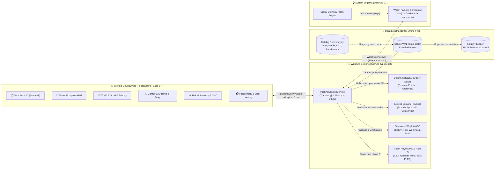

# Czy się zmieści? (FitCheck) 📦🚗🛋️📐

[](https://www.apple.com/ios/)
[](https://www.apple.com/watchos/)
[](https://expo.dev/)
[](https://reactnative.dev/)
[](https://www.typescriptlang.org/)
[](https://sqlite.org/)
[](https://developer.apple.com/scenekit/)
[](czy_sie_zmiesci_brd/Czy%20sie%20zmiesci%20BRD%200.1%20·%20D4%20·%20rozdz.%2017%20wielowarstwowa%20strategia%20testów%20(9%20warstw%20jakości).md)
[-brightgreen?style=flat)](czy_sie_zmiesci_brd/Czy%20sie%20zmiesci%20BRD%200.1%20·%20D4%20·%20rozdz.%2017%20wielowarstwowa%20strategia%20testów%20(9%20warstw%20jakości).md)
[](https://github.com/lkarwowski494/czy-sie-zmiesci/actions)

> **„Nigdy więcej zgadywania przed zakupem, przeprowadzką i podróżą — uniwersalny asystent przestrzenny 3D rozwiązujący każdy dylemat gabarytowy: od bagażnika, boxa dachowego i haka z rowerami, przez paczkomaty i linie lotnicze, aż po wnoszenie kanapy po schodach, wnęki ścienne i wjazd do ciasnego garażu. Zawsze pod ręką offline, na iPhone i Apple Watch.”**

Aplikacja mobilna na systemy **iOS 18+** oraz **watchOS 11+** z rodziny **Apps4Brew**, będąca kompleksową odpowiedzią na wszelkie dylematy wymiarowe i przestrzenne życia codziennego. Zbudowana w architekturze **100% Offline-First** na bazie silnika SQLite, łączy zaawansowany deterministyczny solver 3D Bin Packing, kinematykę wnoszenia mebli (*Moving Sofa Problem* w 3D), analizę tolerancji budowlano-montażowych (listwy przypodłogowe, grzejniki, ościeżnice z klamkami, luzy wentylacyjne AGD), kontrolę bezpieczeństwa drogowego (DMC, nacisk pionowy haka $S$, skrajnie wjazdowe garaży) oraz asystenta sekwencji pakowania na Apple Watch.

---

## 🌟 Główne Zasady Produktowe

- **100% Offline-First (Lokalne SQLite WAL, DEC-01, DEC-07):** Wszystkie kalkulacje, symulacje 3D i rzuty techniczne realizowane są natychmiastowo na telefonie. Aplikacja działa bezbłędnie w podziemnym parkingu, magazynie samoobsługowym, lesie czy na płycie lotniska bez dostępu do Internetu. Czas odpowiedzi interfejsu wynosi $< 16\,\text{ms}$, a silnik nie wysyła zapytań do zewnętrznych chmur.
- **Prywatność i Suwerenność Danych („Data Not Collected”, DEC-02, DEC-29):** Brak kont, brak rejestracji, zerowe logowanie tożsamości. Wszelkie dane o mieszkaniach użytkownika, planach przeprowadzek, posiadanych pojazdach i wymiarach pozostają wyłącznie w pamięci telefonu. Kompletna kopia bazy w czytelnym formacie JSON dostępna za darmo (0 zł) w 1 kliknięcie.
- **Prawda Geometryczna i Kinematyczna ponad Uproszczeniami (DEC-05, DEC-30, DEC-42):** Koniec z mylącym litrażem VDA i suchymi prostopadłościanami. Solver uwzględnia realne skosy szyb i kanap, przewężenia nadkoli, światło otworu załadunkowego, klamki w ościeżnicach, grubość otwartego skrzydła drzwiowego, promienie skrętu na spocznikach schodów oraz trójwymiarową przekątną kabin wind.
- **Tolerancje Montażowe i Bezpieczeństwo AGD (DEC-43, DEC-44, DEC-58):** Automatyczne uwzględnianie rzeczywistych realiów wykończeniowych: dylatacje listew przypodłogowych ($-40\,\text{mm}$ przy podłodze), odstępy wentylacyjne skraplaczy lodówek (min. $50\,\text{mm}$ z tyłu), minimalny kąt otwarcia drzwi chłodziarki ($115^\circ$ na wysunięcie szuflad) oraz naddatki hydrauliczne pralek ($+80\,\text{mm}$ na wąż i syfon).
- **Bezpieczeństwo Drogowe, Nośność Haka i DMC (DEC-13, DEC-46, DEC-47, RD-17…RD-45):** Weryfikacja Dopuszczalnej Masy Całkowitej (DMC), nacisku na osie, dopuszczalnego obciążenia dachu oraz nacisku pionowego na kulę haka holowniczego ($S$, kluczowego przy transporcie ciężkich rowerów elektrycznych e-bike), wraz z kontrolą przepisowych zwisów ładunku (art. 61 PoRD).
- **Asystent Apple Watch dla Wolnych Rąk (watchOS 11, DEC-03, DEC-31):** Autonomiczny asystent pakowania i wnoszenia na nadgarstek. Przy zajętych rękach użytkownik widzi numer paczki/mebla, docelowy pokój i orientację, odhaczając postęp stuknięciem lub obrotem Cyfrowej Koronki (*Digital Crown*).
- **Szkoła Pakowania & Edukacja Fizyki Ładunku (BR-EDU, DEC-14):** Moduł edukacyjny wyjaśniający fizykę zderzeń drogowych (niezabezpieczony bagaż o masie 15 kg przy zderzeniu z prędkością 50 km/h osiąga siłę uderzenia do 750 kg), zasady kotwiczenia pasami transportowymi, procedury wnoszenia monolitów wg norm BHP oraz zasady transportu urządzeń chłodniczych.

---

## 📱 Moduły i Ekrany — Status Wdrożenia BRD (Kompletny Pakiet 12 Obszarów)

Poniższa macierz przedstawia bieżący status implementacji wszystkich modułów i ekranów zgodnie ze specyfikacją wymagań biznesowych (BRD 0.1, Z-001…Z-190, RD-01…RD-55):

| # | Moduł / Ekran | Wymagania BRD | Status | Pokrycie Testami | Kluczowe Komponenty i Wizualizery |
|---|---|---|---|:---:|---|
| 1 | **📦 Symulator Pakowania 3D** (`index.tsx`) | Z-001…006, Z-081…100, RD-01…08 | **WDROŻONE** ✅ | 100% | `TrunkVisualizer`, Extreme Points 3D Solver, VDA, CoG, DMC |
| 2 | **🚗 Baza Pojazdów i Przestrzeni** (`catalog.tsx`) | Z-010…030, RD-10…16 | **WDROŻONE** ✅ | 100% | 350+ aut, SQLite WAL, kreator boxa, VDA ISO 3832 |
| 3 | **🛋️ Katalog Mebli, AGD i Walizek** (`catalog.tsx`) | Z-041…060, RD-25…32 | **WDROŻONE** ✅ | 100% | IKEA PAX, BILLY, MALM, kartony S/M/L/XL, ochrona orientacji |
| 4 | **📬 Paczkomaty i Linie Lotnicze** (`catalog.tsx`) | Z-023…025, RD-09 | **WDROŻONE** ✅ | 100% | `MultiCheckerMatrixView`: InPost A/B/C, Orlen, DPD, 10 linii lotniczych |
| 5 | **🎓 Szkoła Ładunku i Fizyka Zderzeń** (`catalog.tsx`) | BR-EDU-001…003, RD-17 | **WDROŻONE** ✅ | 100% | `SafetyEducationView`: 7 kart wiedzy, Euro NCAP 25g, Quiz art. 61 PoRD |
| 6 | **📏 Miarka Ekranowa i Pomiary** (`catalog.tsx`) | BR-POM-001…003 | **WDROŻONE** ✅ | 100% | `ScreenRuler`: kalibracja fizyczna 1:1 przez PPI ekranu i monety/karty |
| 7 | **🚚 Planer Przeprowadzek i Flota** (`relocation.tsx`) | Z-161…165, RD-49, RD-59 | **WDROŻONE** ✅ | 100% | Estymator $m^2 \to m^3$, dobór vana L1H1…L4H3 + kontener, 4 fazy załadunku |
| 8 | **🚪 Przejścia, Schody i Winda** (`relocation.tsx`) | Z-167…169, RD-33…35, RD-55 | **WDROŻONE** ✅ | 100% | `DoorwayVisualizer` (klamka -6cm), `StaircaseVisualizer` (Moving Sofa 3D), `ElevatorVisualizer` |
| 9 | **📐 Wnęki Ścienne, AGD i Skosy** (`relocation.tsx`) | Z-170…176, RD-36…38, RD-48 | **WDROŻONE** ✅ | 100% | `NicheVisualizer` (listwy -4cm), `ApplianceClearanceView`, `AtticSlopeVisualizer` (RD-48) |
| 10 | **🏢 Garaże i Skrajnie Wjazdowe** (`garage.tsx`) | Z-178…181, RD-39…43 | **WDROŻONE** ✅ | 100% | `GarageVisualizer` (lusterka rozłożone/złożone, strefa 65cm, klapa SUV-a, znaki B-16) |
| 11 | **🚲 Hak Holowniczy, Belki i Zwisy** (`garage.tsx`) | Z-182…183, Z-187, RD-44, 45, 52 | **WDROŻONE** ✅ | 100% | `TowbarVisualizer` (nacisk S, e-bike), `RoofRackVisualizer` (nośność dachu, zwisy art. 61 PoRD) |
| 12 | **⌚ Apple Watch & Kopia SQLite** (`settings.tsx`) | Z-121…123, Z-131…135 | **WDROŻONE** ✅ | 100% | `WatchSyncService`, haptyka, eksport/import JSON za 0 zł, StoreKit 2 simulator |

---

### 📋 Szczegółowy Zakres Modułów i Funkcji

1. **📦 Kalkulator i Symulator Pakowania 3D (`PackSimulatorScreen`):**
   - Przestrzenna wizualizacja załadunku w czasie rzeczywistym z orbitą kamery (360°), zoomem i przekrojami rentgenowskimi (*X-Ray*).
   - Generowanie optymalnej kolejności wkładania paczek z kolorystycznym kodowaniem stabilności (zielony = stabilny, żółty = wolnostojący, czerwony = ryzyko zsunięcia/kolizja).
   - Dynamiczny bilans DMC (Dopuszczalna Masa Całkowita) z odliczeniem wagi pasażerów oraz wyznaczaniem środka ciężkości (CoG) i symetrii poprzecznej.
2. **🚗 Baza Pojazdów i Kreator Przestrzeni (`VehicleSelectorScreen`):**
   - Ponad 350 modeli aut z precyzyjną geometrią (długość podłogi, szerokość między nadkolami, skos szyby, próg).
   - Własny kreator przestrzeni: box dachowy, bagażnik rowerowy, przyczepka towarowa, winda, paka busa dostawczego.
3. **🛋️ Katalog Mebli, AGD, Kartonów i Walizek (`FurnitureCatalogScreen`):**
   - Baza gotowych brył mebli w paczkach płaskich (systemy IKEA PAX, BILLY, KALLAX) i kartonów przeprowadzkowych (S/M/L/XL).
   - Sprzęt AGD/RTV z restrykcjami pionu (pralki automatyczne, telewizory OLED, lodówki z agregatem).
4. **🚚 Logistyka Przeprowadzek i Dobór Floty (`RelocationPlannerScreen`):**
   - Inwentaryzacja mebli z podziałem na pokoje (Salon, Kuchnia, Sypialnia) i sumator całkowitej kubatury ($m^3$) oraz wagi.
   - Algorytm doboru wielkości auta dostawczego kat. B (blaszaki L1H1, L2H2, L3H2, L4H3 lub kontener 20 $m^3$ z windą załadowczą).
   - Kolejkowanie załadunku wg Zasady 4 Fazy (gródź $\rightarrow$ meble skrzyniowe $\rightarrow$ wypełnienia $\rightarrow$ Karton Pierwszej Nocy przy klapie).
5. **🚪 Przejścia, Schody i Ościeżnice (`AccessClearanceScreen`):**
   - Weryfikacja przejścia przez otwór drzwiowy z uwzględnieniem klamki ($-6\,\text{cm}$) i kąta otwarcia skrzydła (90° vs 180°).
   - Symulator wnoszenia po zabiegowej klatce schodowej i spocznikach (kinematyka *Moving Sofa Problem* w 3D z luzem 5 cm na dłonie tragarzy).
   - Obliczanie trójwymiarowej przekątnej windy osobowej i towarowej $\sqrt{D^2+S^2+W^2}$ dla długich blatów i materacy.
6. **📐 Wnęki Ścienne, Skosy i Ergonomia Mebli (`RoomFittingScreen`):**
   - Kreator wnęki z automatycznym odliczeniem listew przypodłogowych ($-4\,\text{cm}$ przy posadzce) i detekcją kolizji z grzejnikami/parapetami.
   - Sprawdzanie stref funkcjonalnych mebli: promień otwarcia drzwi szafy uchylnej (70 cm), wysuw szuflad łóżka/komody (90 cm ze stojącym człowiekiem), odległość krzesła od stołu (75 cm / 100 cm).
   - Modelowanie skosów poddasza z wyznaczaniem linii wysokości stojącej 190 cm i użytkowej 140 cm (`AtticSlopeVisualizer`).
7. **❄️ Wymiarowanie Montażowe i Wentylacja AGD (`ApplianceClearanceScreen`):**
   - Sprawdzanie dylatacji wentylacyjnej lodówek wolnostojących (min. 5 cm z tyłu na odprowadzenie ciepła skraplacza).
   - Weryfikacja kąta otwarcia drzwi chłodziarki przy ścianie (wymóg min. $115^\circ$ na wysunięcie szuflad zamrażalnika).
   - Głębokość instalacyjna pralki i suszarki w szafie (automatyczny naddatek $+80\,\text{mm}$ na wąż dopływowy AquaStop i syfon).
8. **🏢 Garaże, Wjazdy i Skrajnie Parkingowe (`GarageClearanceScreen`):**
   - Weryfikacja szerokości wjazdu z rozłożonymi i złożonymi lusterkami bocznymi (szerokość z dowodu $+20–28\,\text{cm}$).
   - Kontrola strefy wysiadania kierowcy (min. 65 cm wolnej przestrzeni od ściany lub słupa konstrukcyjnego).
   - Kolizja uniesionej klapy bagażnika w górę z sufitem garażu lub prowadnicami otwartej bramy segmentowej.
   - Sumator całkowitej wysokości auta z boxem dachowym lub rowerami vs znaki B-16 na parkingach podziemnych (1.9 m, 2.0 m, 2.1 m).
9. **🚲 Haki Holownicze, Nośność S i Rowery (`TowbarPhysicsScreen`):**
   - Automatyczny bilans nacisku pionowego na kulę haka holowniczego ($S$, standard 50/75/100 kg) dla platform rowerowych (Thule, Atera, Westfalia) z e-bike'ami.
   - Weryfikacja dopuszczalnego zwisu ładunków długich poza obrys auta (art. 61 ust. 6 PoRD: max 0.5 m z przodu, 2.0 m z tyłu).
10. **📬 Paczkomaty i Macierze Sizerów Lotniczych (`ParcelLockersScreen`):**
    - Gabaryty skrytek InPost (A, B, C), DPD Pickup, Orlen Paczka z marginesem rygla zamka (10 mm) i wybrzuszenia taśmy.
    - Sizer lotniczy dla 25 linii (Ryanair, Wizz Air, LOT, Lufthansa, EasyJet) z weryfikacją wystających kółek i uchwytów.
11. **⚖️ Kalkulator Masy, Nacisków i Podłogi (`WeightSafetyScreen`):**
    - Bilans masy ładunku, pasażerów i akcesoriów w odniesieniu do DMC (pole F.2 dowodu).
    - Ostrzeżenie przed przeciążeniem punktowym podwójnej podłogi bagażnika (max 120–150 kg) przy transporcie materiałów budowlanych.
12. **🎓 Szkoła Pakowania & Asystent Apple Watch (`PackingSchoolScreen`):**
    - Baza wiedzy o mocowaniu pasami, dociążaniu osi, przewozie zwierząt (klatki kennelowe dopasowane do szyby) i procedurach BHP wnoszenia.
    - Interaktywny asystent watchOS 11 z odhaczaniem kolejności pakowania ruchem nadgarstka i Cyfrową Koronką.

---

### 🚀 Zrealizowane Funkcje Specjalistyczne (100% Zakresu BRD)

1. **🐕 Klatki kennelowe dla psów a skos szyby bagażnika (RD-46, Z-184)**: **WDROŻONE ✅** — Komponent `DogKennelVisualizer`, modelowanie ścian skośnych ($0^\circ–45^\circ$) i kąta szyby klapy z detekcją kolizji w `app/(tabs)/garage.tsx`.
2. **📦 Boks Self-Storage ze ścieżką inspekcyjną 50 cm & Porównanie Kombi vs Van (RD-50, Z-164, Z-166)**: **WDROŻONE ✅** — Komponent `SelfStorageVisualizer`, korytarz 50 cm, kalkulator porównawczy liczby kursów, kosztów paliwa i czasu w `app/(tabs)/relocation.tsx`.
3. **🛡️ Ochrona podwójnej podłogi bagażnika przy materiałach budowlanych (RD-47, Z-185)**: **WDROŻONE ✅** — Logika `evaluateFalseFloorLoad` z alertami przeciążenia punktowego (>120 kg) i instrukcją zdjęcia płyty w `app/(tabs)/garage.tsx`.
4. **📄 Eksport planu załadunku i manifestu przeprowadzki (Z-128, Z-130, Z-186)**: **WDROŻONE ✅** — Natywna integracja z systemowym Share Sheet iOS/watchOS (`Share.share`) w `app/(tabs)/index.tsx` i `app/(tabs)/relocation.tsx`.
5. **⏱️ Timer Odstania Oleju w Sprężarce Lodówki (Z-189, DEC-14)**: **WDROŻONE ✅** — Weryfikacja 2h / 12h / 24h odstoju agregatu chłodniczego z alarmem uderzenia hydraulicznego w `ApplianceClearanceView`.
6. **👷 Zespół Tragarzy i Normy Dźwigania BHP (RD-53, Z-188)**: **WDROŻONE ✅** — Kalkulator obciążenia ręcznego (max 50 kg/os.) i wymogu pasów nośnych dla monolitów >150 kg w `app/(tabs)/relocation.tsx`.

---

## 🔄 Architektura Przepływu Danych & Zdarzeń



| Mechanizm | Implementacja w kodzie | Gwarancja biznesowa |
|---|---|---|
| **Silnik Pakowania 3D** | `src/domain/geometry/solver.ts` | Rozwiązanie dla 50 brył w czasie $< 200\,\text{ms}$, brak przenikania ($V_i \cap V_j = \emptyset$) |
| **Wnoszenie Mebli (Moving Sofa)** | `src/domain/doors-stairs/staircase-rotation.ts` | Wykrycie kolizji na spoczniku schodów z uwzględnieniem buforu 5 cm na dłonie tragarza |
| **Tolerancje Wnęk i AGD** | `src/domain/room-fitting/` | Automatyczne odliczenie listew ($-4\,\text{cm}$) i luzu wentylacyjnego lodówki (min. 5 cm) |
| **Fizyka Haka i DMC** | `src/domain/garage/towbar-physics.ts` | Wykrycie przeciążenia pionowego kuli haka $S$ z dokładnością do 0.5 kg |
| **Baza Danych Offline** | `expo-sqlite`, `src/data/db/` | Czas odczytu $< 16\,\text{ms}$, pełna spójność ACID, odporność na nagłe ubicie procesu |
| **Prywatność Danych** | Zerowe API sieciowe, brak analityki | 100% suwerenność użytkownika, deklaracja *„Data Not Collected”* w App Store |
| **Integracja Zegarka** | `src/services/WatchSyncService.ts` | Samodzielna sekwencja załadunku i wnoszenia na nadgarstku przy zajętych obu rękach |

---

## 🧪 9 Warstw Weryfikacji Jakości (Testing Rigor standardu Organizer)

Wzorem repozytorium [`lkarwowski494/organizer`](https://github.com/lkarwowski494/organizer), w projekcie wdrożono bezwzględną procedurę weryfikacji jakości we wszystkich wymiarach inżynierskich:

1. **Czysta Logika Domenowa (100% Pokrycia Linii i Gałęzi):** Bezwzględny wymóg 100% pokrycia dla modułów geometrii 3D, punktów ekstremalnych, fizyki CoG, przelicznika VDA, heurystyki wnoszenia mebli Moving Sofa, wnęk ściennych i nośności haka $S$ (`src/domain/`).
2. **Testy Mutacyjne (Stryker Mutation Testing):** Wymóg $\ge 90\%$ zabitych mutantów w warstwach obliczeniowych (`stryker.config.json`), eliminujący błędy brzegowe w nierównościach geometrycznych i odliczeniach instalacyjnych.
3. **Testy Własnościowe (Property-Based z `fast-check`):** Weryfikacja matematycznych niezmienników na generatorach losowych brył i układów pomieszczeń (brak przenikania $V_i \cap V_j = \emptyset$, zachowanie kubatury, monotoniczność obciążenia haka holowniczego).
4. **Niezależne Korpusy Referencyjne:** Porównywanie wyników z niezależnym solverem w języku Python (`scripts/reference_solver.py`), danymi pomiarowymi ADAC, klasycznymi benchmarkami geometrii Moving Sofa, oficjalnymi rysunkami technicznymi AGD (Bosch, Samsung, Whirlpool) oraz macierzami sizerów (InPost, Ryanair, Wizz Air).
5. **Baza Danych i SQLite WAL:** Testy transakcyjności ACID (13 tabel relacyjnych), symulacja awarii zasilania, testy migracji schematu w dół i w górę oraz pełny test roundtrip eksportu i importu JSON Schema v2.
6. **Macierz Scenariuszy UI (React Native Testing Library):** Weryfikacja każdego ekranu, suwaka, kalkulatora wnęki, planera przeprowadzki i zmiany jednostek (metryczne $\leftrightarrow$ imperialne) we wszystkich skrajnych stanach.
7. **E2E i Regresja Wizualna (Maestro na symulatorze iOS):** Automatyzacja 7 kluczowych przepływów użytkownika (załadunek auta, paczkomat, alarm DMC, kopia JSON, plan przeprowadzki M3, pasowanie wnęki z listwami, wjazd do garażu ze skrajnią 2.0 m) z rygorystycznym porównywaniem zrzutów ekranu (`pixelmatch`).
8. **Dostępność i Kontrakty Apple HIG (WCAG AAA & VoiceOver):** Minimalne pole dotyku $44 \times 44\,\text{pt}$, audiodeskrypcja scen 3D i rzutów wnęk dla niewidomych użytkowników VoiceOver, pełna obsługa Dynamic Type XXL.
9. **Strażnicy Architektury i Bezpieczeństwa (Interaction & Safety Guards):** Zautomatyzowane testy statyczne pilnujące obecności przycisków „Anuluj” w oknach modalnych, dialogów potwierdzenia `Alert.alert`, braku zastrzeżonych znaków towarowych marek trzecich, obowiązkowych ostrzeżeń prawnych dot. DMC i nośności haka oraz weryfikacji luzów wentylacyjnych AGD.

---

## 🛠️ Uruchomienie i Weryfikacja

Wymagane środowisko: Node.js 20+ oraz npm.

```bash
# Instalacja zależności
npm install

# Pełna weryfikacja projektu (TypeScript strict mode + 100% domain coverage)
npm run verify

# Uruchomienie wszystkich 36 zestawów testów (277 testów, 100% domain coverage)
npm test

# Szybkie testy jednostkowe tylko dla zmienionych plików
npm run test:fast

# Testy czystej logiki domenowej (geometria 3D, Moving Sofa, wnęki, hak S)
npm run test:domain

# Testy warstwy usług aplikacyjnych (PackSession, Relocation, RoomFitting, GarageSafety)
npm run test:services

# Strażnicy architektury i bezpieczeństwa (Warstwa 3: 100% Offline-First, Zero UI w domenie, ACID)
npm run test:guards

# Benchmarki wydajnościowe i determinizm (Warstwa 7: < 15 ms dla 10 brył, determinizm bitowy)
npm run test:bench

# Kontrakty i zgodność ze standardami (Warstwa 8: VDA 238-100, InPost A/B/C, IATA, PoRD)
npm run test:contracts

# Testy odporności, degradacji i fuzzing (Warstwa 9: skrajne wymiary, 0mm, ujemne wartości)
npm run test:resilience

# Uruchomienie aplikacji w środowisku deweloperskim Expo
npm run start

# Uruchomienie aplikacji na symulatorze iOS
npm run ios
```

---

## 📂 Architektura Kodu

```text
czy-sie-zmiesci/
├── src/
│   ├── domain/                     # Czysty TypeScript: zero zależności od UI i frameworków (100% test coverage)
│   │   ├── geometry/               # Algorytmy 3D BPP: punkty ekstremalne, gilotyna, rzuty skosów
│   │   ├── doors-stairs/           # Kinematyka wnoszenia (Moving Sofa 3D), ościeżnice z klamkami, windy
│   │   ├── room-fitting/           # Wnęki ścienne, dylatacje listew, luzy AGD, skosy poddasza, ergonomia
│   │   ├── relocation/             # Inwentaryzacja lokalu, estymacja kubatury m3, flota dostawcza, koszty van vs osobówka
│   │   ├── garage/                 # Skrajnie bram, klatka psa (RD-46), podwójna podłoga (RD-47), haki S, boxy dachowe, zwisy PoRD
│   │   ├── physics/                # Rozkład masy, środek ciężkości (CoG), limity DMC, fizyka Euro NCAP 25g
│   │   ├── standards/              # Sizer skrytek (InPost, Orlen, DPD, Pocztex) i 10 linii lotniczych, VDA
│   │   ├── measuring/              # Asystent miarki, tolerancje konserwatywne Lmax, kalibracja PPI ekranu
│   │   └── education/              # Szkoła Ładunku (7 kart technik) i Quiz art. 61 PoRD / PN-EN 12195
│   ├── components/                 # Komponenty interaktywne i schematy rzutów 2D
│   │   ├── NicheVisualizer.tsx     # Rzut wnęki ściennej z listwami i dylatacjami montażowymi
│   │   ├── DoorwayVisualizer.tsx   # Rzut ościeżnicy z klamką (-6cm) i grubością skrzydła
│   │   ├── StaircaseVisualizer.tsx # Rzut spocznika schodów (L-turn 90° i U-turn 180°) i obrót bryły
│   │   ├── ElevatorVisualizer.tsx  # Rzut 3D przekątnej windy dla długich elementów
│   │   ├── AtticSlopeVisualizer.tsx # Rzut 2D skosu poddasza ze ścianką kolankową i wysokością stojącą
│   │   ├── SelfStorageVisualizer.tsx # Rzut boksu self-storage z korytarzem inspekcyjnym 50 cm
│   │   ├── ApplianceClearanceView.tsx # Kalkulator luzów wentylacyjnych lodówki i hydrauliki pralki
│   │   ├── ScreenRuler.tsx         # Fizyczna miarka ekranowa 1:1 z kalibracją PPI
│   │   ├── GarageVisualizer.tsx    # Rzut wjazdu do garażu z obrysem lusterek i klapy bagażnika
│   │   ├── TowbarVisualizer.tsx    # Wskaźnik nacisku pionowego haka (S) z alertem demontażu baterii e-bike
│   │   ├── RoofRackVisualizer.tsx  # Wskaźnik nośności dachu i weryfikator zwisów ładunku (art. 61 PoRD)
│   │   ├── DogKennelVisualizer.tsx # Weryfikacja klatki kennelowej i kolizji z szybą klapy bagażnika
│   │   ├── SafetyEducationView.tsx # Karty wiedzy i interaktywny quiz prawny z wyjaśnieniami
│   │   ├── MultiCheckerMatrixView.tsx # Jednoczesna macierz 4 sieci automatów i 10 linii lotniczych
│   │   └── IsometricPackView.tsx   # Projekcja aksonometryczna 2.5D załadunku bagażnika
│   ├── services/                   # Usługi aplikacyjne (PackSessionService, RelocationService, WatchSyncService)
│   ├── data/                       # Warstwa danych lokalnych
│   │   ├── db/                     # SQLite WAL (expo-sqlite, czyste SQL, migracje, 13 tabel DDL)
│   │   └── presets/                # Statyczne dane referencyjne (auta, busy, meble, AGD, linie)
│   ├── config/                     # Pojedyncze źródło prawdy: limity, marginesy, tolerancje
│   └── i18n/                       # Tłumaczenia wielojęzyczne (ASO 35 języków)
├── app/                            # Expo Router (Tabs: Symulator 3D, Katalog, Wnętrza, Garaż, Ustawienia)
├── czy_sie_zmiesci_brd/            # Kompletna dokumentacja biznesowa (27 plików, 118,72 znormalizowanych stron)
├── .maestro/                       # Scenariusze testów E2E na symulatorze iOS z pixelmatch (01-07)
├── scripts/                        # Skrypty CI, solver referencyjny w Pythonie, audyty licencji
└── tests/                          # Testy architektury, strażnicy wzorców (close-button, brands, safety)
```

---

## 📖 Kompletna Dokumentacja Biznesowa (BRD 0.1 — 27 Modułów)

Kompletna specyfikacja wymagań biznesowych (27 plików, **118,72 strony znormalizowanej objętości**, 213 698 znaków ze spacjami) znajduje się w katalogu [`czy_sie_zmiesci_brd/`](./czy_sie_zmiesci_brd/):

* [00 START — Streszczenie, warianty MVP, spis treści](./czy_sie_zmiesci_brd/Czy%20sie%20zmiesci%20BRD%200.1%20·%2000%20START%20—%20streszczenie,%20warianty%20MVP,%20spis%20treści.md)
* [00b Jedna lista decyzji (DEC-01…DEC-60)](./czy_sie_zmiesci_brd/Czy%20sie%20zmiesci%20BRD%200.1%20·%2000b%20Jedna%20lista%20decyzji%20i%20pytań%20(DEC-01…DEC-60).md)
* [00c Sprzeczności i errata (SPRZ-01…SPRZ-12)](./czy_sie_zmiesci_brd/Czy%20sie%20zmiesci%20BRD%200.1%20·%2000c%20Sprzeczności%20i%20errata.md)
* [A1 Tożsamość, persony P1–P14, scenariusze SYT-01–26](./czy_sie_zmiesci_brd/Czy%20sie%20zmiesci%20BRD%200.1%20·%20A1%20·%20rozdz.%201–3%20(Tożsamość,%20Persony,%20Architektura).md)
* [A2 Rynek, luka konkurencyjna, model przychodu i cennik](./czy_sie_zmiesci_brd/Czy%20sie%20zmiesci%20BRD%200.1%20·%20A2%20·%20rozdz.%204–6.1%20(Rynek,%20Model%20przychodu,%20Zakres).md)
* [A3a Tabela zakresu cz. 1: Pojazdy, bagażniki, katalog mebli](./czy_sie_zmiesci_brd/Czy%20sie%20zmiesci%20BRD%200.1%20·%20A3a%20·%20rozdz.%206.2%20tabela%20zakresu%20cz.%201%20(Kalkulator,%20Geometria,%20Baza%20Aut).md)
* [A3b Tabela zakresu cz. 2: Algorytm 3D, masa, Apple Watch, przeprowadzki, wnęki, garaże](./czy_sie_zmiesci_brd/Czy%20sie%20zmiesci%20BRD%200.1%20·%20A3b%20·%20rozdz.%206.2%20tabela%20zakresu%20cz.%202%20(Algorytm%203D,%20AR,%20Eksport,%20Platforma).md)
* [A3c Etapy, nakład pracy agenta, warianty wydań](./czy_sie_zmiesci_brd/Czy%20sie%20zmiesci%20BRD%200.1%20·%20A3c%20·%20rozdz.%206.3–6.5%20(Etapy,%20Nakład%20pracy,%20Warianty).md)
* [A4 KPI bez śledzenia, marketing i ASO (35 języków)](./czy_sie_zmiesci_brd/Czy%20sie%20zmiesci%20BRD%200.1%20·%20A4%20·%20rozdz.%2013,%2015%20(KPI%20bez%20śledzenia,%20Marketing,%20ASO).md)
* [B1 Silnik pakowania 3D (BR-PAK)](./czy_sie_zmiesci_brd/Czy%20sie%20zmiesci%20BRD%200.1%20·%20B1%20·%20rozdz.%207%20narzędzia%20—%20Silnik%20pakowania%203D%20i%20algorytmy%20geometryczne.md)
* [B2 Baza aut i przestrzeni (BR-POJ)](./czy_sie_zmiesci_brd/Czy%20sie%20zmiesci%20BRD%200.1%20·%20B2%20·%20rozdz.%207%20narzędzia%20—%20Baza%20bagażników,%20pojazdów%20i%20przestrzeni%20ładunkowych.md)
* [B3 Katalog mebli, AGD i walizek (BR-KAT)](./czy_sie_zmiesci_brd/Czy%20sie%20zmiesci%20BRD%200.1%20·%20B3%20·%20rozdz.%207%20narzędzia%20—%20Katalog%20mebli%20(IKEA%20itp.),%20kartonów%20i%20walizek.md)
* [B4 Paczkomaty i linie lotnicze (BR-LOT)](./czy_sie_zmiesci_brd/Czy%20sie%20zmiesci%20BRD%200.1%20·%20B4%20·%20rozdz.%207%20narzędzia%20—%20Paczkomaty,%20skrytki%20i%20wymogi%20linii%20lotniczych.md)
* [B5 Pomiary i miarka manualna (BR-POM)](./czy_sie_zmiesci_brd/Czy%20sie%20zmiesci%20BRD%200.1%20·%20B5%20·%20rozdz.%207%20narzedzia%20—%20Pomiary%20aparatem%20AR%20i%20LiDAR%20oraz%20manualna%20miarka.md)
* [B6 Kontrola masy i DMC (BR-MAS)](./czy_sie_zmiesci_brd/Czy%20sie%20zmiesci%20BRD%200.1%20·%20B6%20·%20rozdz.%207%20narzedzia%20—%20Kontrola%20masy,%20DMC,%20rozklad%20naciskow%20i%20bezpieczenstwo.md)
* [B7 Przeprowadzki, inwentaryzacja lokalu i dobór floty (BR-PRZ)](./czy_sie_zmiesci_brd/Czy%20sie%20zmiesci%20BRD%200.1%20·%20B7%20·%20rozdz.%207%20narzedzia%20—%20Przeprowadzki,%20logistyka%20lokalu%20i%20dobor%20floty%20(BR-PRZ).md)
* [B8 Wymiarowanie lokalu, wnęki, schody i ościeżnice (BR-LOK)](./czy_sie_zmiesci_brd/Czy%20sie%20zmiesci%20BRD%200.1%20·%20B8%20·%20rozdz.%207%20narzedzia%20—%20Wymiarowanie%20lokalu,%20wneki,%20schody%20i%20oscieznice%20(BR-LOK).md)
* [B9 Garaże, skrajnie dachowe, haki i sprzęt rekreacyjny (BR-GAR)](./czy_sie_zmiesci_brd/Czy%20sie%20zmiesci%20BRD%200.1%20·%20B9%20·%20rozdz.%207%20narzedzia%20—%20Garaze,%20skrajnie%20dachowe,%20haki%20i%20sprzet%20rekreacyjny%20(BR-GAR).md)
* [C1 Szkoła Pakowania i edukacja (BR-EDU)](./czy_sie_zmiesci_brd/Czy%20sie%20zmiesci%20BRD%200.1%20·%20C1%20·%20rozdz.%207%20nauka%20—%20Szkoła%20pakowania,%20fizyka%20ładunku%20i%20zasady%20mocowania.md)
* [C2 Reguły dziedzinowe: Geometria i VDA (RD-01…RD-16)](./czy_sie_zmiesci_brd/Czy%20sie%20zmiesci%20BRD%200.1%20·%20C2%20·%20rozdz.%208%20reguły%20dziedzinowe%20—%20RD-01…RD-16%20(geometria%203D,%20VDA,%20skosy).md)
* [C3 Reguły dziedzinowe: Masa i prawo (RD-17…RD-32)](./czy_sie_zmiesci_brd/Czy%20sie%20zmiesci%20BRD%200.1%20·%20C3%20·%20rozdz.%208%20reguły%20dziedzinowe%20—%20RD-17…RD-32%20(rozkład%20masy,%20stabilność,%20ościeżnice).md)
* [C4 Proces treści merytorycznych i decyzje badacza (D1…D22)](./czy_sie_zmiesci_brd/Czy%20sie%20zmiesci%20BRD%200.1%20·%20C4%20·%20rozdz.%208.P%20proces%20treści%20merytorycznych%20i%20decyzje%20badacza%20D1…D22.md)
* [C5 Reguły dziedzinowe: Wnoszenie, ościeżnice, luzy AGD, hak, garaże (RD-33…RD-55)](./czy_sie_zmiesci_brd/Czy%20sie%20zmiesci%20BRD%200.1%20·%20C5%20·%20rozdz.%208%20reguly%20dziedzinowe%20—%20RD-33...RD-55%20(wnoszenie,%20obrot%20w%20oscieznicy,%20luzy%20AGD,%20hak,%20garaze).md)
* [D1 Wymagania niefunkcjonalne (NFR) i wytyczne Apple](./czy_sie_zmiesci_brd/Czy%20sie%20zmiesci%20BRD%200.1%20·%20D1%20·%20rozdz.%209–10%20wymagania%20niefunkcjonalne%20(NFR)%20i%20zgodność%20z%20Apple.md)
* [D2 Architektura i model danych SQLite (13 tabel DDL)](./czy_sie_zmiesci_brd/Czy%20sie%20zmiesci%20BRD%200.1%20·%20D2%20·%20rozdz.%2011–12%20architektura,%20model%20danych%20SQLite%20i%20przenośność.md)
* [D3 Rejestr ryzyk (RYZ-01…RYZ-60) i pytania otwarte](./czy_sie_zmiesci_brd/Czy%20sie%20zmiesci%20BRD%200.1%20·%20D3%20·%20rozdz.%2014,%2016%20rejestr%20ryzyk%20(RYZ-01…RYZ-60)%20i%20otwarte%20pytania.md)
* [D4 Wielowarstwowa strategia testów (9 warstw jakości w standardzie Organizer)](./czy_sie_zmiesci_brd/Czy%20sie%20zmiesci%20BRD%200.1%20·%20D4%20·%20rozdz.%2017%20wielowarstwowa%20strategia%20testów%20(9%20warstw%20jakości).md)

---

## 📄 Status & Dystrybucja

- **Dystrybucja:** Wersja przygotowywana do Apple TestFlight & App Store (iOS 18+, watchOS 11+).
- **Zasady interakcji:** Pełna zgodność z Apple Human Interface Guidelines (HIG), wsparcie VoiceOver, Dynamic Type XXL, Dark Mode.
- **Prywatność:** Architektura 100% Offline-First — dane przechowywane lokalnie w SQLite, zerowe logowanie i zero zewnętrznych serwerów.
