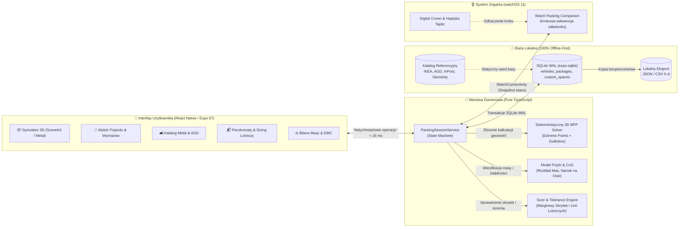

# Czy się zmieści? (FitCheck) 📦🚗📐

[](https://www.apple.com/ios/)
[](https://www.apple.com/watchos/)
[](https://expo.dev/)
[](https://reactnative.dev/)
[](https://www.typescriptlang.org/)
[](https://sqlite.org/)
[](https://developer.apple.com/scenekit/)
[](czy_sie_zmiesci_brd/Czy%20sie%20zmiesci%20BRD%200.1%20·%20D4%20·%20rozdz.%2017%20wielowarstwowa%20strategia%20testów%20(9%20warstw%20jakości).md)
[](czy_sie_zmiesci_brd/Czy%20sie%20zmiesci%20BRD%200.1%20·%20D4%20·%20rozdz.%2017%20wielowarstwowa%20strategia%20testów%20(9%20warstw%20jakości).md)
[](https://github.com/lkarwowski494/czy-sie-zmiesci/actions)

> **„Nigdy więcej zastanawiania się pod marketem, czy kanapa wejdzie do auta — precyzyjny asystent pakowania 3D, weryfikacja DMC i gabarytów offline, zawsze pod ręką na iPhone i Apple Watch.”**

Aplikacja mobilna na systemy **iOS 18+** oraz **watchOS 11+** z rodziny **Apps4Brew**, rozwiązująca problem załadunku przedmiotów do samochodów osobowych, automatów paczkowych, wind i luku bagażowego samolotów. Zbudowana w architekturze **100% Offline-First** na bazie silnika SQLite, łączy zaawansowany solver trójwymiarowego upakowania prostopadłościanów (*3D Bin Packing Problem* z uwzględnieniem skosów szyb i nadkoli), kontrolę bezpieczeństwa drogowego (DMC i nacisk na osie) oraz asystenta sekwencji pakowania na zegarek Apple Watch.

---

## 🌟 Główne Zasady Produktowe

- **100% Offline-First (Lokalne SQLite WAL, DEC-01, DEC-07):** Wszystkie ekrany czytają i modyfikują stan w lokalnej bazie SQLite (`expo-sqlite`, `WAL mode`). Aplikacja działa bezbłędnie w podziemnym parkingu, magazynie meblowym, lesie czy na płycie lotniska bez dostępu do Internetu. Czas renderowania widoku wynosi $< 16\,\text{ms}$, a silnik pakowania nie wykonuje żadnych zewnętrznych zapytań HTTP.
- **Prywatność i Suwerenność Danych („Data Not Collected”, DEC-02, DEC-29):** Brak kont, brak rejestracji, zerowe logowanie tożsamości. Wszystkie dane o pojazdach użytkownika, ładunkach i pomiarach pozostają wyłącznie w pamięci telefonu. Kompletna kopia bazy w formacie JSON/CSV dostępna za darmo (0 zł) w 1 kliknięcie.
- **Fizyka i Deterministyczny Silnik 3D (Extreme Points + Guillotine, DEC-05, DEC-30, BR-PAK):** Deterministyczny algorytm w czystym TypeScript (`src/domain/geometry/`), rozwiązujący załadunek do 50 brył w czasie $< 200\,\text{ms}$. Solver uwzględnia realne ograniczenia bagażnika: kąt nachylenia oparć tylnej kanapy i tylnej szyby, przewężenia nadkoli oraz minimalne światło otworu załadunkowego klapy.
- **Bezpieczeństwo i Przepisy Ruchu Drogowego (DMC & CoG, DEC-13, RD-17…RD-23, BR-MAS):** Automatyczny bilans masy ładunku i pasażerów w odniesieniu do dopuszczalnej ładowności (pole F.2 dowodu rejestracyjnego). Aplikacja oblicza środek ciężkości (Center of Gravity — CoG), ostrzega przed destabilizacją pojazdu, przeciążeniem tylnej osi oraz zasłonięciem pola widzenia wstecznego (art. 61 ust. 2 pkt 3 ustawy Prawo o Ruchu Drogowym).
- **Asystent Apple Watch dla Wolnych Rąk (watchOS 11, DEC-03, DEC-31):** Niezależny asystent pakowania na nadgarstek. Gdy użytkownik trzyma w rękach ciężki karton lub pralkę, Apple Watch prezentuje krok po kroku numer paczki, miejsce położenia i orientację, umożliwiając haptyczne odhaczenie załadunku stuknięciem lub obrotem Cyfrowej Koronki (*Digital Crown*).
- **Szkoła Pakowania & Edukacja Fizyki Ładunku (BR-EDU, DEC-14):** Baza wiedzy wyjaśniająca mechanikę zderzeń drogowych (niezabezpieczona walizka o masie 15 kg przy zderzeniu z prędkością 50 km/h osiąga siłę uderzenia do 450–750 kg), zasady mocowania ładunku pasami transportowymi, dociążanie osi oraz procedury transportu gabarytów.
- **Pojedyncze Źródło Prawdy (Single Source of Truth, DEC-35):** Wszelkie wymiary sizerów lotniczych (Ryanair, Wizz Air, LOT), gabaryty skrytek paczkomatowych (InPost A/B/C) oraz limity geometryczne zdefiniowane są w centralnym module `src/config/`, podlegając ścisłym testom kontraktowym.

---

## 📱 Moduły i Ekrany

1. **📦 Kalkulator i Symulator Pakowania 3D (`PackSimulatorScreen`):**
   - Przestrzenna wizualizacja załadunku w czasie rzeczywistym z płynną orbitą kamery (360°), zoomem i przekrojami rentgenowskimi (*X-Ray*).
   - Generowanie optymalnej kolejności wkładania paczek (od ściany grodziowej do progu bagażnika) z numeracją kroków.
   - Kolorystyczne kodowanie stabilności (zielony = podparty z 3 stron, żółty = wolnostojący, czerwony = ryzyko zsunięcia).
2. **🚗 Baza Pojazdów i Przestrzeni Ładunkowych (`VehicleSelectorScreen`):**
   - Ponad 350 fabrycznych modeli aut (hatchback, kombi, sedan, SUV, van) ze szczegółowymi wymiarami geometrycznymi i normą VDA (kostki 200×100×50 mm).
   - Tryby konfiguracji wnętrza: 5 miejsc (z półką / roletą), 5 miejsc (do dachu z siatką), 2 miejsca (złożona kanapa) oraz płaska podłoga.
   - Własny kreator przestrzeni ładunkowych: box dachowy, bagażnik rowerowy, przyczepka towarowa, winda osobowa, bagażnik busa.
3. **🛋️ Katalog Mebli, AGD, Kartonów i Walizek (`FurnitureCatalogScreen`):**
   - Baza gotowych brył najpopularniejszych mebli w paczkach płaskich (systemy PAX, BILLY, KALLAX), standardowe kartony przeprowadzkowe (S/M/L/XL).
   - Sprzęt AGD i elektronika z restrykcjami pionu (pralka automatyczna: zakaz transportu poziomego ze względu na bęben; telewizory OLED: wyłącznie transport pionowy).
4. **📬 Paczkomaty i Skrytki Kurierskie (`ParcelLockersScreen`):**
   - Automaty paczkowe: InPost (Gabaryt A: $8\times38\times64\,\text{cm}$, B: $19\times38\times64\,\text{cm}$, C: $41\times38\times64\,\text{cm}$), DPD Pickup, Orlen Paczka, DHL POP BOX.
   - Automatyczny bufor bezpieczeństwa (5 mm luzu) kompensujący odkształcenia kartonu i taśmy pakowej.
5. **✈️ Bagaż Lotniczy i Macierze Sizerów (`AviationBaggageScreen`):**
   - Rygorystyczne macierze wymiarów bagażu podręcznego i rejestrowanego dla 25 linii lotniczych (Ryanair, Wizz Air, PLL LOT, Lufthansa, KLM, EasyJet).
   - Weryfikacja elementów wystających (kółka, uchwyty, kieszenie boczne) pod kątem wpasowania w fizyczny sizer na lotnisku.
6. **⚖️ Kalkulator Masy, Nacisków i DMC (`WeightSafetyScreen`):**
   - Interaktywny kalkulator sumarycznej masy ładunku, pasażerów i akcesoriów dachowych.
   - Wskaźnik przeciążenia osi tylnej z alarmem graficznym i ostrzeżeniem prawnym o mandacie i utracie dowodu rejestracyjnego przy przekroczeniu DMC.
7. **📏 Miarka Manualna i Asystent Wymiarowania (`ManualMeasureScreen`):**
   - Błyskawiczny kalkulator trzech wymiarów ($D \times S \times W$) w centymetrach oraz calach z autodetekcją objętości w litrach.
   - Historia ostatnich pomiarów, etykietowanie własnymi nazwami i transfer 1 kliknięciem do aktywnej sesji załadunku.
8. **🎓 Szkoła Pakowania & Edukacja Bezpieczeństwa (`PackingSchoolScreen`):**
   - 8 profesjonalnych procedur merytorycznych: punkty kotwiczenia pasów w bagażniku, blokada oparcia tylnej kanapy pasami bezpieczeństwa przy braku pasażerów, przewóz choinki, nart i rowerów.
   - Interaktywne kalkulatory siły uderzeniowej przy gwałtownym hamowaniu.
9. **⚙️ Ustawienia, Kopia Zapasowa i Eksport (`SettingsScreen`):**
   - 100% lokalny backup bazy SQLite do pliku JSON z kontrolą sumaryczną i mechanizmem bezpiecznego odzyskiwania.
   - Konfiguracja haptyki zegarka i telefonu, wybór motywu (Dark Mode zoptymalizowany pod ekrany OLED) oraz audyt zerowych uprawnień sieciowych.

---

## 🔄 Architektura Przepływu Danych & Zdarzeń



| Mechanizm | Implementacja w kodzie | Gwarancja biznesowa |
|---|---|---|
| **Silnik Pakowania 3D** | `src/domain/geometry/solver.ts` | Wyznaczenie układu dla 50 brył w czasie $< 200\,\text{ms}$, brak przenikania ($V_i \cap V_j = \emptyset$) |
| **Model Fizyki i Mas** | `src/domain/physics/centerOfGravity.ts` | Precyzyjna kontrola DMC i wyznaczenie środka ciężkości CoG z dokładnością do 1 cm |
| **Baza Danych Offline** | `expo-sqlite`, `src/data/db/` | Czas odczytu $< 16\,\text{ms}$, pełna spójność ACID, odporność na nagłe ubicie procesu |
| **Prywatność Danych** | Zerowe API sieciowe, brak analityki | 100% suwerenność użytkownika, deklaracja *„Data Not Collected”* w App Store |
| **Integracja Zegarka** | `src/features/watch/` | Samodzielna sekwencja załadunku na nadgarstku przy zajętych obu rękach |

---

## 🧪 9 Warstw Weryfikacji Jakości (Testing Rigor standardu Organizer)

Wzorem repozytorium [`lkarwowski494/organizer`](https://github.com/lkarwowski494/organizer), w projekcie wdrożono bezwzględną procedurę weryfikacji jakości we wszystkich wymiarach inżynierskich:

1. **Czysta Logika Domenowa (100% Pokrycia Linii i Gałęzi):** Bezwzględny wymóg 100% pokrycia dla modułów geometrii 3D, punktów ekstremalnych, fizyki CoG, przelicznika VDA i tolerancji sizerów (`src/domain/`).
2. **Testy Mutacyjne (Stryker Mutation Testing):** Wymóg $\ge 90\%$ zabitych mutantów w warstwie obliczeniowej geometrii (`stryker.config.json`), gwarantujący odporność na błędy brzegowe w pętlach i nierównościach geometrycznych.
3. **Testy Własnościowe (Property-Based z `fast-check`):** Weryfikacja matematycznych niezmienników na generatorach losowych brył:
   - *Brak przenikania:* Dla każdej pary spakowanych paczek $i \neq j$ przecięcie wnętrz jest puste ($V_i \cap V_j = \emptyset$).
   - *Zachowanie kubatury:* Sumaryczna objętość ładunku nigdy nie przekracza pojemności bagażnika.
   - *Niezmiennik masy:* $\sum m_i = M_{\text{total}}$.
4. **Niezależne Korpusy Referencyjne:** Porównywanie wyników upakowania z niezależnym solverem napisanym w języku Python (`scripts/reference_solver.py`), danymi pomiarowymi ADAC oraz oficjalnymi macierzami sizerów (InPost, Ryanair, Wizz Air).
5. **Baza Danych i SQLite WAL:** Testy transakcyjności ACID, symulacja awarii i nagłego ubicia procesu, testy migracji schematu w dół i w górę oraz pełny test roundtrip eksportu i importu JSON.
6. **Macierz Scenariuszy UI (React Native Testing Library):** Weryfikacja każdego ekranu, suwaka, zmiany jednostek (cm $\leftrightarrow$ in, kg $\leftrightarrow$ lb) we wszystkich skrajnych stanach formularza.
7. **E2E i Regresja Wizualna (Maestro na symulatorze iOS):** Automatyzacja pełnych ścieżek użytkownika (od wyboru auta, przez dodanie mebli IKEA, po symulację 3D) z rygorystycznym porównywaniem zrzutów ekranu (`pixelmatch`).
8. **Dostępność i Kontrakty Apple HIG (WCAG AAA & VoiceOver):** Minimalne pole dotyku $44 \times 44\,\text{pt}$, audiodeskrypcja sceny 3D dla niewidomych użytkowników VoiceOver, pełna obsługa Dynamic Type XXL.
9. **Strażnicy Architektury i Bezpieczeństwa (Interaction & Architecture Guards):** Automatyczne testy-strażnicy pilnujące obecności przycisków „Anuluj / Zamknij” w nagłówkach okien modalnych, ochrony przed roszczeniami znaków towarowych firm trzecich oraz obecności disclaimera prawnego o odpowiedzialności kierowcy za załadunek.

---

## 🛠️ Uruchomienie i Weryfikacja

Wymagane środowisko: Node.js 20+ oraz npm.

```bash
# Instalacja zależności
npm install

# Pełna weryfikacja projektu (typy, lint, testy z pokryciem 100%, strażnicy architektury)
npm run check

# Uruchomienie testów jednostkowych i integracyjnych Jest
npm test

# Szybkie testy jednostkowe tylko dla zmienionych plików
npm run test:fast

# Testy czystej logiki domenowej (geometria 3D, fizyka, sizer)
npm run test:domain

# Uruchomienie testów mutacyjnych Stryker
npm run test:mutation

# Uruchomienie testów własnościowych fast-check
npm run test:property

# Uruchomienie aplikacji w środowisku deweloperskim Expo
npm run start

# Uruchomienie aplikacji na symulatorze iOS
npm run ios
```

---

## 📂 Architektura Kodu

```text
czy-sie-zmiesci/
├── src/
│   ├── domain/                     # Czysty TypeScript: zero zależności od React Native i Expo
│   │   ├── geometry/               # Algorytmy 3D BPP: punkty ekstremalne, gilotyna, rzuty skosów
│   │   ├── physics/                # Rozkład masy, środek ciężkości (CoG), limity DMC
│   │   ├── sizing/                 # Wymiarowanie i tolerancje sizerów (Paczkomaty, linie lotnicze)
│   │   └── vda/                    # Przelicznik litrażu i kostek normy DIN 70020 / VDA
│   ├── features/                   # Moduły funkcjonalne i ekrany użytkownika
│   │   ├── simulator/              # Interaktywny widok załadunku 3D (SceneKit / Metal)
│   │   ├── vehicles/               # Przeglądarka bazy modeli samochodów i kreator bagażnika
│   │   ├── catalog/                # Wyszukiwarka paczek meblowych IKEA, AGD i kartonów
│   │   ├── lockers/                # Sizer skrytek paczkomatowych i bagażu lotniczego
│   │   ├── weight/                 # Kalkulator nacisków na osie i ostrzeżenia DMC
│   │   ├── manual-measure/         # Szybka miarka manualna (D x S x W)
│   │   ├── school/                 # Szkoła pakowania, zasady mocowania pasów i quizy
│   │   ├── watch/                  # Komunikacja z Apple Watch (WatchConnectivity, snapshoty)
│   │   └── settings/               # Kopia zapasowa JSON, motywy, audyt danych
│   ├── data/                       # Warstwa danych lokalnych
│   │   ├── db/                     # SQLite WAL (expo-sqlite, czyste zapytania SQL, migracje)
│   │   └── presets/                # Statyczne dane referencyjne (auta, s日常生活, linie lotnicze)
│   ├── config/                     # Pojedyncze źródło prawdy: limity, marginesy, tolerancje
│   └── i18n/                       # Tłumaczenia wielojęzyczne (ASO 35 języków)
├── czy_sie_zmiesci_brd/            # Kompletna dokumentacja biznesowa (23 pliki, 84 znormalizowane strony)
├── .maestro/                       # Scenariusze testów E2E na symulatorze iOS z pixelmatch
├── scripts/                        # Skrypty weryfikacji CI, solver referencyjny w Pythonie, audyty licencji
└── tests/                          # Testy architektury, strażnicy wzorców (close-button, brands-guard)
```

---

## 📖 Kompletna Dokumentacja Biznesowa (BRD 0.1)

Szczegółowa, modułowa specyfikacja wymagań biznesowych (23 pliki, 84,10 strony znormalizowanej objętości) znajduje się w katalogu [`czy_sie_zmiesci_brd/`](./czy_sie_zmiesci_brd/):

* [00 START — Streszczenie, warianty MVP, spis treści](./czy_sie_zmiesci_brd/Czy%20sie%20zmiesci%20BRD%200.1%20·%2000%20START%20—%20streszczenie,%20warianty%20MVP,%20spis%20treści.md)
* [00b Jedna lista decyzji (DEC-01…DEC-41)](./czy_sie_zmiesci_brd/Czy%20sie%20zmiesci%20BRD%200.1%20·%2000b%20Jedna%20lista%20decyzji%20i%20pytań%20(DEC-01…DEC-41).md)
* [00c Sprzeczności i errata](./czy_sie_zmiesci_brd/Czy%20sie%20zmiesci%20BRD%200.1%20·%2000c%20Sprzeczności%20i%20errata.md)
* [A1 Tożsamość, persony P1–P8, scenariusze SYT-01–15](./czy_sie_zmiesci_brd/Czy%20sie%20zmiesci%20BRD%200.1%20·%20A1%20·%20rozdz.%201–3%20(Tożsamość,%20Persony,%20Architektura).md)
* [A2 Rynek, luka konkurencyjna, model przychodu i cennik](./czy_sie_zmiesci_brd/Czy%20sie%20zmiesci%20BRD%200.1%20·%20A2%20·%20rozdz.%204–6.1%20(Rynek,%20Model%20przychodu,%20Zakres).md)
* [A3a Tabela zakresu cz. 1: Pojazdy, bagażniki, katalog mebli](./czy_sie_zmiesci_brd/Czy%20sie%20zmiesci%20BRD%200.1%20·%20A3a%20·%20rozdz.%206.2%20tabela%20zakresu%20cz.%201%20(Kalkulator,%20Geometria,%20Baza%20Aut).md)
* [A3b Tabela zakresu cz. 2: Algorytm 3D, masa, Apple Watch, platforma](./czy_sie_zmiesci_brd/Czy%20sie%20zmiesci%20BRD%200.1%20·%20A3b%20·%20rozdz.%206.2%20tabela%20zakresu%20cz.%202%20(Algorytm%203D,%20AR,%20Eksport,%20Platforma).md)
* [A3c Etapy, nakład pracy agenta, warianty wydań](./czy_sie_zmiesci_brd/Czy%20sie%20zmiesci%20BRD%200.1%20·%20A3c%20·%20rozdz.%206.3–6.5%20(Etapy,%20Nakład%20pracy,%20Warianty).md)
* [A4 KPI bez śledzenia, marketing i ASO (35 języków)](./czy_sie_zmiesci_brd/Czy%20sie%20zmiesci%20BRD%200.1%20·%20A4%20·%20rozdz.%2013,%2015%20(KPI%20bez%20śledzenia,%20Marketing,%20ASO).md)
* [B1 Silnik pakowania 3D (BR-PAK)](./czy_sie_zmiesci_brd/Czy%20sie%20zmiesci%20BRD%200.1%20·%20B1%20·%20rozdz.%207%20narzędzia%20—%20Silnik%20pakowania%203D%20i%20algorytmy%20geometryczne.md)
* [B2 Baza aut i przestrzeni (BR-POJ)](./czy_sie_zmiesci_brd/Czy%20sie%20zmiesci%20BRD%200.1%20·%20B2%20·%20rozdz.%207%20narzędzia%20—%20Baza%20bagażników,%20pojazdów%20i%20przestrzeni%20ładunkowych.md)
* [B3 Katalog mebli, AGD i walizek (BR-KAT)](./czy_sie_zmiesci_brd/Czy%20sie%20zmiesci%20BRD%200.1%20·%20B3%20·%20rozdz.%207%20narzędzia%20—%20Katalog%20mebli%20(IKEA%20itp.),%20kartonów%20i%20walizek.md)
* [B4 Paczkomaty i linie lotnicze (BR-LOT)](./czy_sie_zmiesci_brd/Czy%20sie%20zmiesci%20BRD%200.1%20·%20B4%20·%20rozdz.%207%20narzędzia%20—%20Paczkomaty,%20skrytki%20i%20wymogi%20linii%20lotniczych.md)
* [B5 Pomiary i miarka manualna (BR-POM)](./czy_sie_zmiesci_brd/Czy%20sie%20zmiesci%20BRD%200.1%20·%20B5%20·%20rozdz.%207%20narzedzia%20—%20Pomiary%20aparatem%20AR%20i%20LiDAR%20oraz%20manualna%20miarka.md)
* [B6 Kontrola masy i DMC (BR-MAS)](./czy_sie_zmiesci_brd/Czy%20sie%20zmiesci%20BRD%200.1%20·%20B6%20·%20rozdz.%207%20narzedzia%20—%20Kontrola%20masy,%20DMC,%20rozklad%20naciskow%20i%20bezpieczenstwo.md)
* [C1 Szkoła Pakowania i edukacja (BR-EDU)](./czy_sie_zmiesci_brd/Czy%20sie%20zmiesci%20BRD%200.1%20·%20C1%20·%20rozdz.%207%20nauka%20—%20Szkoła%20pakowania,%20fizyka%20ładunku%20i%20zasady%20mocowania.md)
* [C2 Reguły dziedzinowe: Geometria i VDA (RD-01…RD-16)](./czy_sie_zmiesci_brd/Czy%20sie%20zmiesci%20BRD%200.1%20·%20C2%20·%20rozdz.%208%20reguły%20dziedzinowe%20—%20RD-01…RD-16%20(geometria%203D,%20VDA,%20skosy).md)
* [C3 Reguły dziedzinowe: Masa i prawo (RD-17…RD-32)](./czy_sie_zmiesci_brd/Czy%20sie%20zmiesci%20BRD%200.1%20·%20C3%20·%20rozdz.%208%20reguły%20dziedzinowe%20—%20RD-17…RD-32%20(rozkład%20masy,%20stabilność,%20ościeżnice).md)
* [C4 Proces treści merytorycznych i decyzje badacza (D1…D22)](./czy_sie_zmiesci_brd/Czy%20sie%20zmiesci%20BRD%200.1%20·%20C4%20·%20rozdz.%208.P%20proces%20treści%20merytorycznych%20i%20decyzje%20badacza%20D1…D22.md)
* [D1 Wymagania niefunkcjonalne (NFR) i wytyczne Apple](./czy_sie_zmiesci_brd/Czy%20sie%20zmiesci%20BRD%200.1%20·%20D1%20·%20rozdz.%209–10%20wymagania%20niefunkcjonalne%20(NFR)%20i%20zgodność%20z%20Apple.md)
* [D2 Architektura i model danych SQLite (DDL)](./czy_sie_zmiesci_brd/Czy%20sie%20zmiesci%20BRD%200.1%20·%20D2%20·%20rozdz.%2011–12%20architektura,%20model%20danych%20SQLite%20i%20przenośność.md)
* [D3 Rejestr ryzyk (RYZ-01…RYZ-45) i pytania otwarte](./czy_sie_zmiesci_brd/Czy%20sie%20zmiesci%20BRD%200.1%20·%20D3%20·%20rozdz.%2014,%2016%20rejestr%20ryzyk%20(RYZ-01…RYZ-45)%20i%20otwarte%20pytania.md)
* [D4 Wielowarstwowa strategia testów (9 warstw jakości w standardzie Organizer)](./czy_sie_zmiesci_brd/Czy%20sie%20zmiesci%20BRD%200.1%20·%20D4%20·%20rozdz.%2017%20wielowarstwowa%20strategia%20testów%20(9%20warstw%20jakości).md)

---

## 📄 Status & Dystrybucja

- **Dystrybucja:** Wersja przygotowywana do Apple TestFlight & App Store (iOS 18+, watchOS 11+).
- **Zasady interakcji:** Pełna zgodność z Apple Human Interface Guidelines (HIG), wsparcie VoiceOver, Dynamic Type XXL, Dark Mode.
- **Prywatność:** Architektura 100% Offline-First — dane przechowywane lokalnie w SQLite, zerowe logowanie i zero zewnętrznych serwerów.
