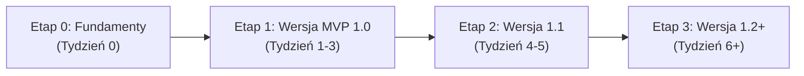

# **Czy się zmieści? (FitCheck) BRD 0.1 — Część A3c**

## **Rozdział 6.3: Etapy Wdrożenia i Harmonogram Wydań**

Realizacja projektu zorganizowana jest w 4 sekwencyjne etapy, zgodnie z filozofią budowy pionowych plastrów (*Vertical Slices*) i ciągłej weryfikacji testami automatycznymi.

### **1. Etap 0: Fundamenty Architektury i Prototyp 3D (Tydzień 0)**
* Inicjalizacja repozytorium, pipeline GitHub Actions dla macOS (`testflight.yml`, `verify.yml`).
* Struktura bazodanowa SQLite (WAL mode, migracje, schemat tabel `spaces`, `vehicles`, `cargo_items`, `pack_sessions`).
* Implementacja deterministycznego silnika Extreme Points 3D w czystym TypeScript/Swift z pokryciem testami jednostkowymi 100%.
* Bazowy renderer SceneKit/Metal wyświetlający prostopadłościany w 60 FPS.

### **2. Etap 1: Wydanie MVP 1.0 (Tydzień 1–3 — Wariant Rekomendowany b+)**
* Kompletny interfejs 5-zakładkowy:
  1. **Pakuj:** Wybór przestrzeni, dodawanie paczek, podgląd 3D na żywo, animacja krok-po-kroku.
  2. **Garaż:** Baza 60 modeli aut, definicje schowków i przestrzeni domowych.
  3. **Katalog:** Gotowe wymiary mebli (IKEA itp.), AGD, paczkomatów (InPost, DPD, Orlen) i linii lotniczych.
  4. **Szkoła Pakowania:** Baza wiedzy o zabezpieczeniu ładunku, fizyce zderzeń, przepisach PoRD i pasach transportowych.
  5. **Ustawienia:** Kopia zapasowa JSON, jednostki (cm/in, kg/lb), zarządzanie subskrypcją StoreKit 2.
* Aplikacja towarzysząca na Apple Watch (watchOS 11): lista paczek i odhaczanie.
* Testy: macierz testów UI, testy regresyjne, testy własnościowe *fast-check* dla silnika 3D.
* Zgłoszenie do App Store i wydanie publiczne.

### **3. Etap 2: Wersja 1.1 (Tydzień 4–5)**
* Rozszerzenie bazy pojazdów do 250 modeli (auta dostawcze, busy, kombi segmentu E).
* Pomiary wspomagane czujnikiem LiDAR (ARKit) dla użytkowników iPhone Pro.
* Eksport szczegółowych raportów załadunku do formatu PDF.
* Live Activities na Dynamic Island w trakcie aktywnego załadunku.

### **4. Etap 3: Wersje 1.2 i 2.x (Rozwój Długoterminowy)**
* Wersja dedykowana na tablet iPad z obsługą Apple Pencil do rysowania rzutów.
* Dedykowany tryb planowania przeprowadzek całych mieszkań.
* Lokalna wymiana projektów załadunku przez AirDrop (0 serwerów chmurowych).

---

## **Rozdział 6.4: Szacowany Nakład Pracy Agenta**

Jednostką nakładu jest **dzień pracy agenta (8h intensywnej pracy obliczeniowo-programistycznej)**. Przy pracy wielowątkowej czas kalendarzowy ulega skróceniu o ok. 50%.

| Moduł / Obszar prac | Zakres prac | Nakład (Dni Agenta) |
| :--- | :--- | :--- |
| **Architektura, Baza SQLite i CI/CD** | Schemat bazy, migracje, kopia JSON, pipeline GitHub Actions, testy-strażnicy | 3–4 dni |
| **Silnik Kombinatoryczny 3D** | Algorytm Extreme Points, Guillotine, sortowanie, fizyka ładunku, testy wektorowe RD | 5–7 dni |
| **Baza Pojazdów i Standardów** | Seedowanie 60 aut, weryfikacja wymiarów w manualach, paczkomaty, lotniska, meble | 4–5 dni |
| **Renderer Wizualny 3D i Rzuty 2D** | SceneKit/Metal, rzut z góry, rzut od klapy, kolory, animacja krok-po-kroku, X-Ray | 5–7 dni |
| **Interfejs Użytkownika (UI/UX)** | 5 zakładek, modale, formularze wymiarów, Dynamic Type, motyw ciemny/jasny | 4–6 dni |
| **Asystent Apple Watch (watchOS 11)** | Niezależna aplikacja zegarkowa, odhaczanie haptyczne, Digital Crown, Smart Stack | 3–4 dni |
| **StoreKit 2, IAP i Family Sharing** | Subskrypcje, zakup dożywotni, paywall, obsługa próbna 14 dni, przywracanie zakupów | 2–3 dni |
| **Dostępność i Lokalizacja (35 języków)** | VoiceOver na wszystkich ekranach, audiodeskrypcja 3D, słowniki i18n, jednostki imp/met | 3–4 dni |
| **Testy, Macierz i Stabilizacja** | E2E Maestro, macierz testów, testy regresji, audyt bezpieczeństwa i braków | 3–5 dni |
| **RAZEM (Wariant b+ Rekomendowany):** | **Kompletny produkt gotowy do publikacji w App Store** | **32–45 dni** *(3–4 tyg. kalendarza)* |

---

## **Rozdział 6.5: Zestawienie Wariantów Wydań**

| Wymiar porównawczy | Wariant (a) Pełne MVP | Wariant (b+) Rekomendowany | Wariant (b) Tylko MUST | Wariant (c) z LiDAR w 1.0 | Wariant (d) Prosty kalkulator |
| :--- | :--- | :--- | :--- | :--- | :--- |
| **Liczba BR** | 172 BR | **132 BR** | 124 BR | 148 BR | 96 BR |
| **Baza aut na start** | 100 aut | **60 aut** | 40 aut | 60 aut | 0 (tylko ręczne) |
| **Apple Watch** | Tak (zaawansowany) | **Tak (asysta pakowania)** | Brak | Tak | Brak |
| **LiDAR / AR** | Wersja 1.1 | **Wersja 1.1** | Wersja 1.1 | **Tak (od 1.0)** | Brak |
| **Moduł Edukacyjny** | Pełny | **Podstawowy (Szkoła)** | Podstawowy | Pełny | Brak |
| **Ryzyko odrzucenia przez Apple** | Minimalne | **Niskie** | Średnie | Minimalne | **Krytycznie wysokie** |
| **Czas kalendarzowy** | 5–6 tygodni | **3–4 tygodnie** | 3–4 tygodnie | 6–8 tygodni | 2 tygodnie |
| **Rekomendacja analityka** | Alternatywna | **GŁÓWNA REKOMENDACJA** | Odradzana | Odradzana | **BEZWZGLĘDNIE ODRZUCONA** |
