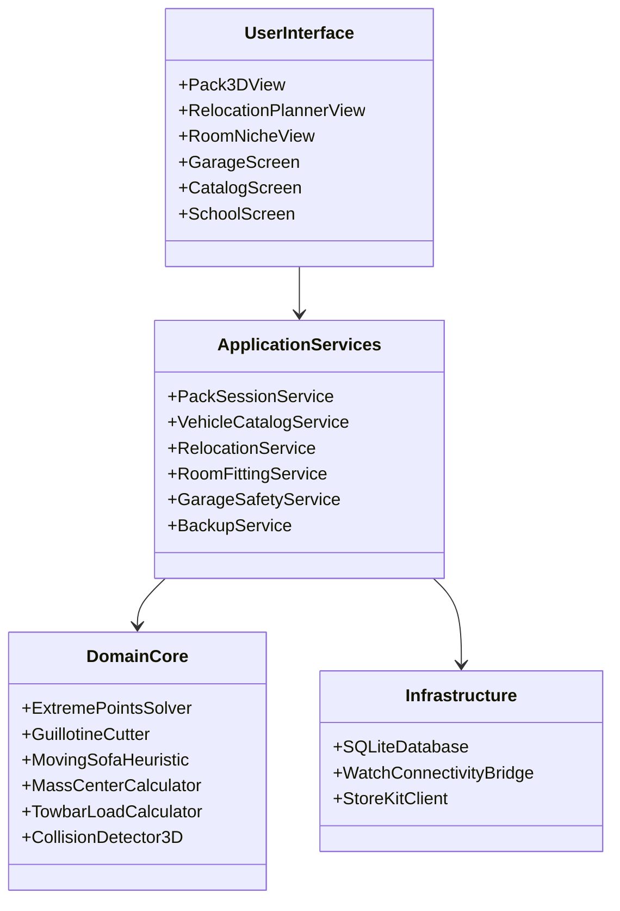

# **Czy się zmieści? (FitCheck) BRD 0.1 — Część D2**

## **Rozdział 11: Architektura Oprogramowania i Struktura Modułów**

Architektura opiera się na wzorcu **Czystej Architektury (Clean Architecture / Hexagonal)**, gwarantującym całkowitą izolację algorytmów geometrycznych od frameworków interfejsu użytkownika i bazy danych.



### **11.1. Warstwy Architektury**
1. **Domain Core (Jądro Domenowe — Czysty TypeScript/Swift):**
   * Brak jakichkolwiek zależności od React Native, Expo, SQLite czy UIKit.
   * Zawiera modele domenowe: `BoundingBox3D`, `ExtremePoint`, `Vector3`, `VehicleGeometry`, `CargoItem`, `DoorwayClearance`, `StaircaseTurn`, `TowbarPhysics`, `RelocationPlan`.
   * Czyste funkcje matematyczne: detekcja kolizji, rotacje kwaternionowe, sortowanie, wyliczanie środka ciężkości, dyskretna trajektoria Moving Sofa.
2. **Application Services (Warstwa Przypadków Użycia):**
   * Orkiestracja sesji pakowania, planowanie przeprowadzek, pasowanie mebli we wnękach, koordynacja zapisu do bazy danych, walidacja reguł bezpieczeństwa DMC i parametrów $S$ haka.
3. **Infrastructure (Warstwa Danych i Sprzętu):**
   * Implementacja repozytoriów SQLite (`PRAGMA foreign_keys = ON; WAL mode`).
   * Mostki komunikacji natywnej (Apple Watch Connectivity, StoreKit 2).
4. **User Interface (Warstwa Prezentacji):**
   * Ekrany aplikacji w Expo Router / SwiftUI z reaktywnym stanem i dedykowanymi kontrolkami SceneKit.

---

## **Rozdział 12: Schemat Bazy Danych SQLite (DDL) i Model Danych**

Baza danych składa się z 13 zoptymalizowanych tabel ze ścisłą integralnością referencyjną i indeksami na kluczach wyszukiwania.

```sql
-- Włączenie kluczy obcych i trybu WAL
PRAGMA foreign_keys = ON;
PRAGMA journal_mode = WAL;

-- 1. Tabela predefiniowanych modeli pojazdów
CREATE TABLE IF NOT EXISTS vehicles (
    id TEXT PRIMARY KEY NOT NULL,
    make TEXT NOT NULL,
    model TEXT NOT NULL,
    generation TEXT NOT NULL,
    body_type TEXT NOT NULL, -- 'kombi', 'hatchback', 'sedan', 'suv', 'van'
    year_from INTEGER NOT NULL,
    year_to INTEGER,
    curb_weight_kg REAL NOT NULL, -- Masa własna (G)
    max_payload_kg REAL NOT NULL, -- Ładowność fabryczna
    gvw_kg REAL NOT NULL, -- Dopuszczalna Masa Całkowita (F.2)
    width_with_mirrors_cm REAL NOT NULL DEFAULT 205.0,
    width_folded_mirrors_cm REAL NOT NULL DEFAULT 190.0,
    roof_load_limit_kg REAL NOT NULL DEFAULT 75.0,
    towbar_s_limit_kg REAL DEFAULT 75.0,
    tailgate_max_height_cm REAL DEFAULT 210.0,
    created_at INTEGER NOT NULL
);

-- 2. Tabela parametrów geometrycznych przestrzeni bagażowych
CREATE TABLE IF NOT EXISTS vehicle_spaces (
    id TEXT PRIMARY KEY NOT NULL,
    vehicle_id TEXT NOT NULL,
    space_name TEXT NOT NULL, -- 'Bagażnik standard', 'Fotele złożone'
    length_floor_cm REAL NOT NULL,
    length_folded_cm REAL NOT NULL,
    width_min_cm REAL NOT NULL, -- Między nadkolami
    width_max_cm REAL NOT NULL, -- Za nadkolami
    height_roof_cm REAL NOT NULL,
    height_shelf_cm REAL NOT NULL,
    tailgate_angle_deg REAL NOT NULL, -- Kąt pochylenia szyby od pionu
    aperture_width_cm REAL NOT NULL, -- Światło otworu klapy
    aperture_height_cm REAL NOT NULL,
    threshold_height_cm REAL NOT NULL, -- Wysokość wewnętrznego progu
    vda_liters INTEGER NOT NULL,
    FOREIGN KEY (vehicle_id) REFERENCES vehicles(id) ON DELETE CASCADE
);

-- 3. Tabela własnych przestrzeni użytkownika (Garaż użytkownika, boksy, windy)
CREATE TABLE IF NOT EXISTS custom_spaces (
    id TEXT PRIMARY KEY NOT NULL,
    name TEXT NOT NULL,
    space_category TEXT NOT NULL, -- 'car', 'roof_box', 'trailer', 'elevator', 'door', 'storage_box'
    length_cm REAL NOT NULL,
    width_cm REAL NOT NULL,
    height_cm REAL NOT NULL,
    is_slanted INTEGER NOT NULL DEFAULT 0, -- 1 jeśli posiada skośną ścianę
    slant_angle_deg REAL DEFAULT 0,
    aperture_width_cm REAL,
    aperture_height_cm REAL,
    max_payload_kg REAL DEFAULT 500,
    is_default INTEGER NOT NULL DEFAULT 0,
    created_at INTEGER NOT NULL
);

-- 4. Tabela katalogu przedmiotów i ładunków
CREATE TABLE IF NOT EXISTS cargo_items (
    id TEXT PRIMARY KEY NOT NULL,
    category TEXT NOT NULL, -- 'furniture', 'appliance', 'luggage', 'parcel', 'diy', 'pet', 'sport'
    name TEXT NOT NULL,
    length_cm REAL NOT NULL,
    width_cm REAL NOT NULL,
    height_cm REAL NOT NULL,
    weight_kg REAL NOT NULL,
    allow_rotation_xyz INTEGER NOT NULL DEFAULT 1,
    allow_rotation_z_only INTEGER NOT NULL DEFAULT 0,
    is_fragile INTEGER NOT NULL DEFAULT 0,
    is_soft INTEGER NOT NULL DEFAULT 0,
    color_hex TEXT NOT NULL DEFAULT '#3B82F6',
    is_preset INTEGER NOT NULL DEFAULT 0, -- 1 = predefiniowany, 0 = stworzony przez użytkownika
    created_at INTEGER NOT NULL
);

-- 5. Tabela aktywnych i zapisanych sesji załadunku
CREATE TABLE IF NOT EXISTS pack_sessions (
    id TEXT PRIMARY KEY NOT NULL,
    name TEXT NOT NULL,
    target_space_id TEXT NOT NULL,
    passengers_count INTEGER NOT NULL DEFAULT 1,
    total_weight_kg REAL NOT NULL DEFAULT 0,
    packing_efficiency_pct REAL NOT NULL DEFAULT 0,
    is_valid INTEGER NOT NULL DEFAULT 1, -- 0 jeśli kolizja lub przeciążenie
    created_at INTEGER NOT NULL,
    updated_at INTEGER NOT NULL
);

-- 6. Tabela alokacji przedmiotów w sesji załadunku (Pozycje 3D)
CREATE TABLE IF NOT EXISTS pack_session_items (
    id TEXT PRIMARY KEY NOT NULL,
    session_id TEXT NOT NULL,
    cargo_item_id TEXT NOT NULL,
    pos_x_cm REAL NOT NULL,
    pos_y_cm REAL NOT NULL,
    pos_z_cm REAL NOT NULL,
    dim_x_cm REAL NOT NULL, -- Wymiary po uwzględnieniu rotacji
    dim_y_cm REAL NOT NULL,
    dim_z_cm REAL NOT NULL,
    sequence_order INTEGER NOT NULL, -- Kolejność wkładania (1, 2, 3...)
    is_packed INTEGER NOT NULL DEFAULT 0, -- Status odhaczenia na Apple Watch
    FOREIGN KEY (session_id) REFERENCES pack_sessions(id) ON DELETE CASCADE,
    FOREIGN KEY (cargo_item_id) REFERENCES cargo_items(id) ON DELETE RESTRICT
);

-- 7. Tabela projektów przeprowadzek
CREATE TABLE IF NOT EXISTS relocation_projects (
    id TEXT PRIMARY KEY NOT NULL,
    name TEXT NOT NULL,
    origin_type TEXT NOT NULL, -- 'apartment', 'house', 'office'
    origin_area_m2 REAL,
    residents_count INTEGER DEFAULT 2,
    clutter_level TEXT DEFAULT 'standard', -- 'minimal', 'standard', 'dense'
    total_volume_m3 REAL NOT NULL DEFAULT 0,
    total_weight_kg REAL NOT NULL DEFAULT 0,
    recommended_vehicle_type TEXT, -- 'van_l2h2', 'van_l3h2', 'box_truck'
    created_at INTEGER NOT NULL
);

-- 8. Tabela pomieszczeń w lokalu
CREATE TABLE IF NOT EXISTS rooms (
    id TEXT PRIMARY KEY NOT NULL,
    project_id TEXT, -- Opcjonalne powiązanie z relocation_projects
    name TEXT NOT NULL, -- 'Salon', 'Sypialnia', 'Kuchnia'
    length_cm REAL NOT NULL,
    width_cm REAL NOT NULL,
    height_cm REAL NOT NULL DEFAULT 260.0,
    skirting_board_thickness_mm REAL NOT NULL DEFAULT 20.0,
    has_attic_slant INTEGER NOT NULL DEFAULT 0,
    knee_wall_height_cm REAL DEFAULT 0,
    roof_angle_deg REAL DEFAULT 0,
    created_at INTEGER NOT NULL,
    FOREIGN KEY (project_id) REFERENCES relocation_projects(id) ON DELETE CASCADE
);

-- 9. Tabela elementów stałych i wnęk pomieszczeń
CREATE TABLE IF NOT EXISTS room_fixtures (
    id TEXT PRIMARY KEY NOT NULL,
    room_id TEXT NOT NULL,
    fixture_type TEXT NOT NULL, -- 'niche', 'radiator', 'window_sill', 'pipe', 'socket'
    pos_x_cm REAL NOT NULL,
    pos_y_cm REAL NOT NULL,
    width_cm REAL NOT NULL,
    depth_cm REAL NOT NULL,
    height_cm REAL NOT NULL,
    protrusion_cm REAL NOT NULL DEFAULT 0, -- Wystawanie w głąb pomieszczenia
    FOREIGN KEY (room_id) REFERENCES rooms(id) ON DELETE CASCADE
);

-- 10. Tabela ciągów komunikacyjnych (Ościeżnice, schody, windy)
CREATE TABLE IF NOT EXISTS access_pathways (
    id TEXT PRIMARY KEY NOT NULL,
    room_id TEXT,
    pathway_type TEXT NOT NULL, -- 'door', 'stairs', 'elevator', 'corridor'
    nominal_width_cm REAL NOT NULL,
    effective_aperture_cm REAL NOT NULL,
    height_cm REAL NOT NULL,
    door_swing_deg REAL DEFAULT 90.0,
    handle_offset_cm REAL DEFAULT 6.0,
    stair_width_cm REAL,
    landing_depth_cm REAL,
    ceiling_clearance_cm REAL,
    elevator_diagonal_cm REAL,
    FOREIGN KEY (room_id) REFERENCES rooms(id) ON DELETE SET NULL
);

-- 11. Tabela inwentarza przeprowadzki
CREATE TABLE IF NOT EXISTS relocation_items (
    id TEXT PRIMARY KEY NOT NULL,
    project_id TEXT NOT NULL,
    room_id TEXT,
    cargo_item_id TEXT NOT NULL,
    quantity INTEGER NOT NULL DEFAULT 1,
    box_label TEXT, -- 'Karton #12', 'Ostrożnie Szkło'
    destination_room TEXT,
    phase_category TEXT NOT NULL DEFAULT 'base', -- 'heavy_appliance', 'base', 'fillers', 'first_night'
    is_loaded INTEGER NOT NULL DEFAULT 0,
    FOREIGN KEY (project_id) REFERENCES relocation_projects(id) ON DELETE CASCADE,
    FOREIGN KEY (room_id) REFERENCES rooms(id) ON DELETE SET NULL,
    FOREIGN KEY (cargo_item_id) REFERENCES cargo_items(id) ON DELETE RESTRICT
);

-- 12. Tabela profili garażowych i parkingów
CREATE TABLE IF NOT EXISTS garage_profiles (
    id TEXT PRIMARY KEY NOT NULL,
    name TEXT NOT NULL,
    gate_width_cm REAL NOT NULL,
    interior_width_cm REAL NOT NULL,
    ceiling_height_cm REAL NOT NULL,
    gate_runner_height_cm REAL,
    obstacle_x_cm REAL, -- Położenie słupa/filaru
    obstacle_width_cm REAL,
    max_entry_sign_m REAL, -- Znak B-16: 1.9, 2.0, 2.1
    created_at INTEGER NOT NULL
);

-- 13. Tabela konfiguracji haków i dachów
CREATE TABLE IF NOT EXISTS towbar_roof_configs (
    id TEXT PRIMARY KEY NOT NULL,
    vehicle_id TEXT NOT NULL,
    towbar_s_limit_kg REAL NOT NULL,
    bike_rack_weight_kg REAL NOT NULL,
    bikes_count INTEGER NOT NULL DEFAULT 2,
    bikes_total_weight_kg REAL NOT NULL,
    roof_limit_kg REAL NOT NULL,
    bars_weight_kg REAL NOT NULL,
    roof_box_weight_kg REAL NOT NULL,
    roof_cargo_weight_kg REAL NOT NULL,
    total_roof_height_cm REAL NOT NULL,
    FOREIGN KEY (vehicle_id) REFERENCES vehicles(id) ON DELETE CASCADE
);

-- Indeksy wydajnościowe
CREATE INDEX IF NOT EXISTS idx_vehicles_make_model ON vehicles(make, model);
CREATE INDEX IF NOT EXISTS idx_cargo_category ON cargo_items(category);
CREATE INDEX IF NOT EXISTS idx_session_items_order ON pack_session_items(session_id, sequence_order);
CREATE INDEX IF NOT EXISTS idx_relocation_items_project ON relocation_items(project_id, phase_category);
CREATE INDEX IF NOT EXISTS idx_room_fixtures_room ON room_fixtures(room_id);
```

---

### **12.2. Format Eksportu / Importu Kopii Zapasowej (JSON Schema)**

Zgodnie z zasadą **ZP-06** pełna zawartość bazy danych eksportowana jest do pojedynczego, czytelnego pliku JSON o następującej strukturze:

```json
{
  "schema_version": 2,
  "bundle_id": "com.apps4brew.fitcheck",
  "exported_at": "2026-10-15T22:00:00Z",
  "device_model": "iPhone16,1",
  "app_version": "1.0.0",
  "data": {
    "custom_spaces": [],
    "user_cargo_items": [],
    "pack_sessions": [],
    "pack_session_items": [],
    "relocation_projects": [],
    "rooms": [],
    "room_fixtures": [],
    "access_pathways": [],
    "relocation_items": [],
    "garage_profiles": [],
    "towbar_roof_configs": []
  }
}
```
*Przed wykonaniem importu serwis walidacyjny sprawdza zgodność `schema_version`, unikalność identyfikatorów UUID oraz spójność kluczy obcych. Import wykonywany jest w pojedynczej transakcji atomowej `BEGIN TRANSACTION ... COMMIT`.*
