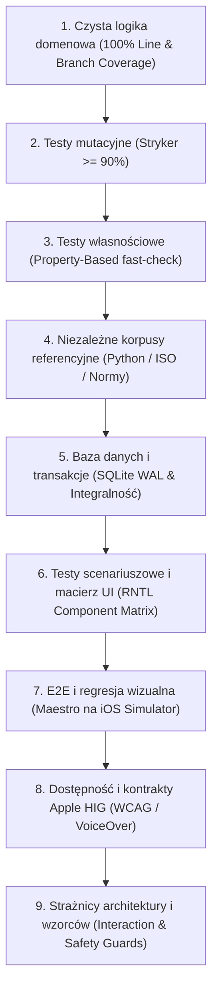

# **Czy się zmieści? (FitCheck) BRD 0.1 — Część D4**

## **Rozdział 17: Wielowarstwowa Strategia Testów (9 Warstw Jakości w Standardzie Organizer)**

W oparciu o standardy inżynieryjne wypracowane w projekcie [`lkarwowski494/organizer`](https://github.com/lkarwowski494/organizer), jakość aplikacji **Czy się zmieści? (FitCheck)** jest gwarantowana przez **9 komplementarnych perspektyw weryfikacji**. Żadna funkcjonalność nie jest uznawana za ukończoną (Definition of Done) bez przejścia pełnego zestawu testów we wszystkich warstwach.

---

### **Warstwa 1: Czysta Logika Domenowa (100% Pokrycia Linii i Gałęzi)**
* **Zakres:** `src/domain/` (algorytmy 3D Bin Packing, stereometria, rzutowanie skosu szyby, bilans DMC, konwersja jednostek, heurystyka wnoszenia mebli Moving Sofa, wnęki i listwy, parametry $S$ haka, skrajnie garażowe).
* **Narzędzia:** Jest, TypeScript.
* **Rygor:** Bezwzględny wymóg **100% Lines, 100% Statements, 100% Functions, 100% Branches**.
* **Kluczowe moduły:**
  * `src/domain/geometry/extreme-points.ts` — generowanie i redukcja punktów wstawienia 3D.
  * `src/domain/geometry/aperture.ts` — weryfikacja przejścia przez światło otworu klapy.
  * `src/domain/doors-stairs/staircase-rotation.ts` — dyskretna heurystyka obrotu mebla na spoczniku schodów (RD-34).
  * `src/domain/doors-stairs/doorway-clearance.ts` — obliczanie efektywnego światła drzwi z klamką i skrzydłem (RD-33).
  * `src/domain/room-fitting/niche-calculator.ts` — wpasowanie we wnękę z dylatacjami listew przypodłogowych (RD-36).
  * `src/domain/room-fitting/appliance-clearance.ts` — luzy wentylacyjne lodówek i głębokość montażowa pralek (RD-37, RD-39).
  * `src/domain/garage/garage-clearance.ts` — weryfikacja szerokości z lusterkami i strefy wysiadania (RD-41).
  * `src/domain/garage/towbar-physics.ts` — bilans nacisku pionowego $S$ dla platform rowerowych (RD-44).
  * `src/domain/relocation/volume-estimator.ts` — szacowanie kubatury mienia z metrażu lokalu (RD-49).

---

### **Warstwa 2: Testy Mutacyjne (Stryker Mutation Testing $\ge 90\%$)**
* **Cel:** Wyeliminowanie „fałszywie zielonych testów”, które pokrywają linie kodu, ale nie sprawdzają asercji przy zmianie operatorów logicznych.
* **Narzędzia:** `@stryker-mutator/core`, `@stryker-mutator/jest-runner`.
* **Próg jakościowy:** **Mutation Score $\ge 90\%$** dla całego katalogu `src/domain/`.
* **Przykładowe mutacje eliminowane przez testy:**
  * Zamiana `<` na `<=` przy weryfikacji kolizji ścianek Bounding Boxa i ościeżnicy.
  * Zamiana `+` na `-` przy dodawaniu marginesu luzu technologicznego $\epsilon = 15\text{ mm}$ lub buforu listew $20\text{ mm}$.
  * Usunięcie odliczenia klamki ($\delta_{\text{klamka}} = 60\text{ mm}$) przy otwarciu drzwi pod kątem $90^\circ$.
  * Wycięcie warunku sprawdzającego limit nośności haka holowniczego $S$.
  * Zmiana znaku współczynnika skosu dachu na poddaszu.

---

### **Warstwa 3: Testy Własnościowe (Property-Based Testing z `fast-check`)**
* **Cel:** Testowanie zachowania algorytmów na tysiącach losowo wygenerowanych, skrajnych danych wejściowych w celu weryfikacji niezmienników matematycznych.
* **Narzędzia:** `fast-check`.
* **Weryfikowane niezmienniki (Invariants):**
  1. **Niezmiennik Nieprzenikalności Materii:** $\forall i \ne j: V_i \cap V_j = \emptyset$.
  2. **Niezmiennik Zachowania Objętości:** $\sum V_{\text{packed}} \le V_{\text{usable}}$.
  3. **Niezmiennik Środka Ciężkości:** Środek masy ładunku $X_{\text{CoG}}$ zawsze leży wewnątrz wypukłej powłoki punktów podparcia.
  4. **Niezmiennik Monotoniczności Obciążenia Haka:** Dodanie kolejnego roweru zawsze ściśle zwiększa całkowity nacisk pionowy na kulę haka.
  5. **Niezmiennik Nieprzekraczalności Światła Drzwi:** Żaden przedmiot o wymiarach poprzecznych większych niż efektywne światło drzwi nie może zostać oznaczony jako „mieszczący się”.

---

### **Warstwa 4: Niezależne Korpusy Referencyjne (External Ground-Truth Corpora)**
* **Cel:** Wyeliminowanie ryzyka, że testy powielają błędy myślowe autora algorytmu.
* **Metoda:** Porównywanie wyników z niezależnym, zewnętrznym wzorcem matematycznym:
  * **Korpus 3D-BPP (Python SciPy / OR-Tools):** Niezależny skrypt w Pythonie rozwiązujący benchmarki załadunkowe Martello & Vigo.
  * **Korpus ISO 3832:** Zestawienie 60 oficjalnych raportów pomiarowych ADAC z kubaturami bagażników zmierzonymi bloczkami VDA.
  * **Korpus Geometrii Moving Sofa:** Zestaw 40 znanych z literatury geometrii zakrętów korytarza L i U ze zweryfikowanymi limitami obrotu brył sztywnych.
  * **Korpus Wymiarów AGD:** Oficjalne specyfikacje instalacyjne 80 modeli lodówek i pralek producentów Bosch, Siemens, Samsung, Whirlpool z uwzględnieniem rysunków technicznych przyłączy.
  * **Korpus Haków i Bagażników:** Dane techniczne 50 fabrycznych haków holowniczych i platform rowerowych Thule, Atera, Westfalia.

---

### **Warstwa 5: Testy Bazy Danych, Transakcji i SQLite WAL**
* **Cel:** Gwarancja odporności na awarie zasilania, ubicie procesu w tle i wielowątkowy dostęp.
* **Narzędzia:** `better-sqlite3` (w testach Node) oraz `expo-sqlite` (na urządzeniu).
* **Zakres:**
  * **Testy Transakcyjności:** Zapis projektu przeprowadzki z 10 pokojami i 80 meblami w pojedynczej transakcji; symulacja awarii i weryfikacja `ROLLBACK`.
  * **Testy Integralności Kluczy Obcych:** Sprawdzenie kaskadowego usuwania pokoi i inwentarza (`ON DELETE CASCADE`).
  * **Testy Migracji Schematu:** Sprawdzenie migracji bazy z wersji v1 do v2 (dodanie tabel przeprowadzek i lokali).
  * **Roundtrip Kopia JSON:** Zapis bazy $\to$ eksport do JSON $\to$ skasowanie bazy $\to$ import z JSON $\to$ porównanie bitowe stanu.

---

### **Warstwa 6: Testy Scenariuszowe i Macierz Komponentów UI (RNTL)**
* **Cel:** Weryfikacja każdego stanu interfejsu, komunikatów walidacji i reakcji na działania użytkownika.
* **Narzędzia:** `@testing-library/react-native`.
* **Zakres Macierzy Testów (`check:matrix`):**
  * Ekrany przeprowadzki: pusty projekt, dodawanie mebla, ostrzeżenie o przekroczeniu kubatury vana, wybór floty dostawczej.
  * Ekrany wnęki ściennej: test suwaka grubości listew przypodłogowych, wykrycie kolizji z grzejnikiem.
  * Ekrany garażowe: test ostrzeżenia przed wjazdem z boxem dachowym przy znaku 2.0 m.
  * Ekrany platformy rowerowej: czerwony alert po dodaniu drugiego roweru e-bike przekraczającego parametr $S = 75\text{ kg}$.

---

### **Warstwa 7: E2E i Regresja Wizualna (Maestro na iOS Simulator)**
* **Cel:** Pełna weryfikacja działania aplikacji w rzeczywistym środowisku systemowym iOS.
* **Narzędzia:** Maestro CLI (`.maestro/`), `pixelmatch` do zrzutów ekranu.
* **Kluczowe Scenariusze E2E (`tests/przeplywy.json`):**
  1. `01-pelny-przeplyw-auto-meble.yaml` — Wybór kombi z bazy, dodanie szafy IKEA, weryfikacja 3D i animacji pakowania.
  2. `02-szybki-test-paczkomat.yaml` — Wpisanie wymiarów paczki, sprawdzenie Gabarytu B InPost.
  3. `03-alarm-dmc-przeladowanie.yaml` — Dodanie 20 worków cementu, weryfikacja czerwonego alertu osi.
  4. `04-kopia-i-przywrocenie.yaml` — Eksport bazy do JSON, wyczyszczenie danych, import i weryfikacja integralności.
  5. `05-przeprowadzka-mieszkania.yaml` — Utworzenie projektu przeprowadzki M3, inwentaryzacja 3 pokoi, dobór busa L2H2, wygenerowanie raportu PDF.
  6. `06-wneka-scienna-listwy.yaml` — Zdefiniowanie wnęki 152 cm, dodanie szafy 150 cm, wykrycie kolizji z listwami 20 mm, zatwierdzenie podcięcia listew.
  7. `07-garaz-box-dachowy.yaml` — Zestawienie auta z boxem dachowym, próba symulacji wjazdu na parking podziemny z limitem 2.0 m, weryfikacja ostrzeżenia o kolizji.

---

### **Warstwa 8: Kontrakty Dostępności (WCAG AAA & Apple HIG)**
* **Cel:** Aplikacja w pełni użyteczna dla seniorów i osób niewidomych.
* **Zakres weryfikacji:**
  * **Minimalny obszar dotyku:** Każdy przycisk, chip i kontrolka posiada pole trafienia min. $44 \times 44\text{ pt}$ (`tests/accessibility-target.test.tsx`).
  * **Kontrast kolorów:** Weryfikacja programowa palety barw pod kątem WCAG AA ($4,5:1$) i AAA ($7:1$) dla trybu jasnego i ciemnego.
  * **VoiceOver Audiodeskrypcja:** Pełne wsparcie dla audiodeskrypcji scen 3D, wnęk ściennych i sekwencji wnoszenia po schodach.

---

### **Warstwa 9: Strażnicy Architektury i Wzorców (Interaction & Safety Guards)**
* **Cel:** Zautomatyzowane testy statyczne chroniące przed regresją architektury i ryzykiem prawnym.
* **Kluczowe testy-strażnicy:**
  * `close-button-guard.test.tsx`: Weryfikuje przycisk „Anuluj” po lewej stronie w nagłówku każdego okna modalnego.
  * `interaction-guards.test.ts`: Pilnuje dialogów potwierdzenia `Alert.alert` przy usuwaniu mebli i projektów.
  * `brands-contract-guard.test.ts`: Blokuje użycie zastrzeżonych logotypów i znaków towarowych marek trzecich.
  * `safety-disclaimer-guard.test.ts`: Gwarantuje obecność ostrzeżenia prawnego dot. odpowiedzialności kierowcy za załadunek oraz nośność haka.
  * `appliance-ventilation-guard.test.ts`: Weryfikuje, czy moduł AGD zawsze wymusza sprawdzenie luzów wentylacyjnych lodówki.
