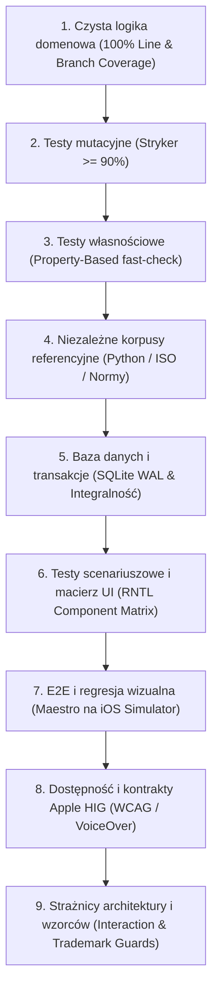

# **Czy się zmieści? (FitCheck) BRD 0.1 — Część D4**

## **Rozdział 17: Wielowarstwowa Strategia Testów (9 Warstw Jakości w Standardzie Organizer)**

W oparciu o standardy inżynieryjne wypracowane w projekcie [`lkarwowski494/organizer`](https://github.com/lkarwowski494/organizer), jakość aplikacji **Czy się zmieści? (FitCheck)** jest gwarantowana przez **9 komplementarnych perspektyw weryfikacji**. Żadna funkcjonalność nie jest uznawana za ukończoną (Definition of Done) bez przejścia pełnego zestawu testów we wszystkich warstwach.

---

### **Warstwa 1: Czysta Logika Domenowa (100% Pokrycia Linii i Gałęzi)**
* **Zakres:** `src/domain/` (algorytmy 3D Bin Packing, stereometria, rzutowanie skosu szyby, bilans DMC, konwersja jednostek).
* **Narzędzia:** Jest, TypeScript.
* **Rygor:** Bezwzględny wymóg **100% Lines, 100% Statements, 100% Functions, 100% Branches**.
* **Kluczowe moduły:**
  * `src/domain/geometry/extreme-points.ts` — generowanie i redukcja punktów wstawienia.
  * `src/domain/geometry/aperture.ts` — weryfikacja przejścia przez światło otworu klapy.
  * `src/domain/physics/mass-center.ts` — wyliczanie środka ciężkości i nacisku osi.
  * `src/domain/standards/vda-calculator.ts` — przeliczanie przestrzeni na bloczki ISO 3832 ($200 \times 100 \times 50\text{ mm}$).
  * `src/domain/standards/lockers.ts` — weryfikacja skrytek paczkomatowych z marginesem rygla.

---

### **Warstwa 2: Testy Mutacyjne (Stryker Mutation Testing $\ge 90\%$)**
* **Cel:** Wyeliminowanie „fałszywie zielonych testów”, które pokrywają linie kodu, ale nie sprawdzają asercji przy zmianie operatorów logicznych.
* **Narzędzia:** `@stryker-mutator/core`, `@stryker-mutator/jest-runner`.
* **Próg jakościowy:** **Mutation Score $\ge 90\%$** dla całego katalogu `src/domain/`.
* **Przykładowe mutacje eliminowane przez testy:**
  * Zamiana `<` na `<=` przy weryfikacji kolizji ścianek Bounding Boxa.
  * Zamiana `+` na `-` przy dodawaniu marginesu luzu technologicznego $\epsilon = 15\text{ mm}$.
  * Wycięcie warunku `is_fragile` przy sortowaniu kolejki załadunku.
  * Zmiana znaku współczynnika pochylenia szyby $\tan(\alpha)$.

---

### **Warstwa 3: Testy Własnościowe (Property-Based Testing z `fast-check`)**
* **Cel:** Testowanie zachowania algorytmów na tysiącach losowo wygenerowanych, skrajnych danych wejściowych w celu weryfikacji niezmienników matematycznych.
* **Narzędzia:** `fast-check`.
* **Weryfikowane niezmienniki (Invariants):**
  1. **Niezmiennik Nieprzenikalności Materii:** Dla dowolnego wygenerowanego zbioru $N$ paczek i dowolnego bagażnika: $\forall i \ne j: V_i \cap V_j = \emptyset$.
  2. **Niezmiennik Zachowania Objętości:** Suma objętości spakowanych paczek nigdy nie może przekraczać użytecznej objętości przestrzeni: $\sum V_{\text{packed}} \le V_{\text{usable}}$.
  3. **Niezmiennik Środka Ciężkości:** Środek masy ładunku $X_{\text{CoG}}$ zawsze leży wewnątrz wypukłej powłoki geometrycznej (Convex Hull) punktów podparcia.
  4. **Niezmiennik Idempotentności Sortowania:** Dwukrotne posortowanie tej samej listy paczek daje identyczny wynik.
  5. **Niezmiennik Pustego Załadunku:** Przeliczenie dla zbioru pustego zwraca $0\text{ kg}$, $0\text{ l}$ i 100% wolnej przestrzeni.

---

### **Warstwa 4: Niezależne Korpusy Referencyjne (External Ground-Truth Corpora)**
* **Cel:** Wyeliminowanie ryzyka, że testy powielają błędy myślowe autora algorytmu.
* **Metoda:** Porównywanie wyników z niezależnym, zewnętrznym wzorcem matematycznym:
  * **Korpus 3D-BPP (Python SciPy / OR-Tools):** Niezależny skrypt w Pythonie rozwiązujący znane w literaturze benchmarki załadunkowe (Martello & Vigo instances) — silnik w TypeScript musi osiągnąć zgodność alokacji.
  * **Korpus ISO 3832:** Zestawienie 60 oficjalnych raportów pomiarowych ADAC z kubaturami bagażników zmierzonymi fizycznymi bloczkami VDA — silnik FitCheck musi wyliczać litraż z dokładnością do 1 bloczka ($\pm 1\text{ litr}$).
  * **Korpus Operatorów Pocztowych i Linii Lotniczych:** Zestaw 120 rzeczywistych paczek i walizek przetestowanych pod kątem wymogów InPost, DPD, Orlen, Ryanair, Wizz Air, LOT.

---

### **Warstwa 5: Testy Bazy Danych, Transakcji i SQLite WAL**
* **Cel:** Gwarancja odporności na awarie zasilania, ubicie procesu w tle i wielowątkowy dostęp.
* **Narzędzia:** `better-sqlite3` (w testach Node) oraz `expo-sqlite` (na urządzeniu).
* **Zakres:**
  * **Testy Transakcyjności:** Zapis sesji załadunku wraz z $N$ pozycjami paczek w pojedynczej transakcji; symulacja rzucenia wyjątku w połowie operacji i weryfikacja automatycznego `ROLLBACK`.
  * **Testy Współbieżności:** Równoległy zapis przez aplikację na telefonie i odczyt przez widget/zegarek (`concurrency.test.ts`).
  * **Testy Migracji Schematu:** Sprawdzenie migracji bazy w górę i w dół (up/down) dla każdej kolejnej wersji schematu SQLite.
  * **Roundtrip Kopia JSON:** Zapis bazy $\to$ eksport do JSON $\to$ skasowanie bazy $\to$ import z JSON $\to$ porównanie bitowe stanu.

---

### **Warstwa 6: Testy Scenariuszowe i Macierz Komponentów UI (RNTL)**
* **Cel:** Weryfikacja każdego stanu interfejsu, komunikatów walidacji i reakcji na działania użytkownika.
* **Narzędzia:** `@testing-library/react-native`.
* **Zakres Macierzy Testów (`check:matrix`):**
  * Każdy ekran posiada testy stanu: Pusty (Empty State), Ładowanie (Loading), Wprowadzanie danych, Sukces (Zmieści się), Błąd/Kolizja (Nie zmieści się), Przeładowanie (Przekroczenie DMC).
  * Przetestowanie każdego suwaka (szerokość, długość, kąt szyby) na wartościach brzegowych ($0$, minimum, maksimum, wartości ujemne zablokowane).
  * Przetestowanie przełącznika jednostek (cm $\leftrightarrow$ cale, kg $\leftrightarrow$ funty) i weryfikacja braku błędów zaokrągleń w interfejsie.

---

### **Warstwa 7: E2E i Regresja Wizualna (Maestro na iOS Simulator)**
* **Cel:** Pełna weryfikacja działania aplikacji w rzeczywistym środowisku systemowym iOS.
* **Narzędzia:** Maestro CLI (`.maestro/`), `pixelmatch` do zrzutów ekranu.
* **Kluczowe Scenariusze E2E (`tests/przeplywy.json`):**
  1. `01-pelny-przeplyw-auto-meble.yaml` — Wybór Skody Octavii z bazy, dodanie szafy PAX z katalogu, weryfikacja podglądu 3D, sprawdzenie animacji załadunku krok-po-kroku.
  2. `02-szybki-test-paczkomat.yaml` — Wpisanie wymiarów paczki z klawiatury, sprawdzenie kafelków InPost Gabaryt B, potwierdzenie zielonego stanu.
  3. `03-alarm-dmc-przeladowanie.yaml` — Dodanie 20 worków cementu, weryfikacja pojawienia się czerwonego alertu przeciążenia osi.
  4. `04-kopia-i-przywrocenie.yaml` — Eksport bazy do pliku JSON, wyczyszczenie danych, import pliku i weryfikacja obecności wcześniejszych aut.

---

### **Warstwa 8: Kontrakty Dostępności (WCAG AAA & Apple HIG)**
* **Cel:** Aplikacja w pełni użyteczna dla seniorów i osób niewidomych.
* **Zakres weryfikacji:**
  * **Minimalny obszar dotyku:** Każdy przycisk, chip i kontrolka posiada pole trafienia min. $44 \times 44\text{ pt}$ (pilnowane testem `tests/accessibility-target.test.tsx`).
  * **Kontrast kolorów:** Weryfikacja programowa palety barw pod kątem WCAG AA ($4,5:1$) i AAA ($7:1$) dla trybu jasnego i ciemnego.
  * **VoiceOver Audiodeskrypcja 3D:** Zamiast pustego widoku Canvas, VoiceOver odczytuje tekstową transkrypcję sceny 3D: *„Załadunek w 65% pełny. 3 paczki ułożone stabilnie, wolna przestrzeń nad roletą: 32 cm”*.

---

### **Warstwa 9: Strażnicy Architektury i Wzorców (Interaction & Trademark Guards)**
* **Cel:** Zautomatyzowane testy statyczne chroniące przed regresją architektury i ryzykiem prawnym.
* **Kluczowe testy-strażnicy:**
  * `close-button-guard.test.tsx`: Weryfikuje, czy każde okno modalne posiada przycisk „Anuluj” po lewej stronie w nagłówku (`headerLeft`).
  * `interaction-guards.test.ts`: Pilnuje, aby usuwanie elementów zawsze wymagało potwierdzenia w dialogu systemowym `Alert.alert`.
  * `brands-contract-guard.test.ts`: Skanuje kod źródłowy, komentarze i pliki językowe, blokując użycie zastrzeżonych znaków towarowych i logotypów innych firm w warstwie prezentacji.
  * `safety-disclaimer-guard.test.ts`: Gwarantuje obecność oficjalnego ostrzeżenia prawnego dot. odpowiedzialności kierowcy za załadunek.
